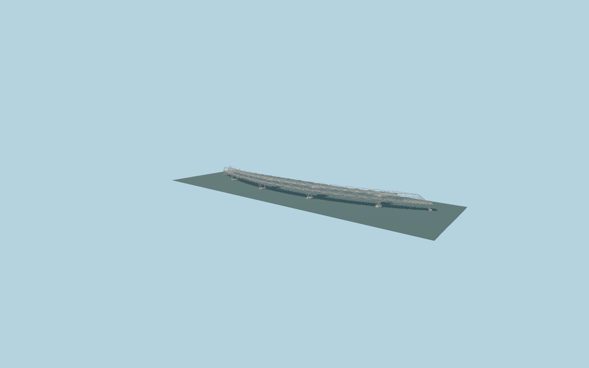

# The Helix Bridge

Curved Singapore crossing with opposing six-strand and five-strand stainless helices, transparent rails, shaded walkway, four bay-side viewing pods and slender tripod piers.

## Evidence

- [Primary reference](https://www.coxarchitecture.com.au/project/the-helix-bridge/)
- [Primary reference](https://teamstainless.org/wp-content/uploads/2025/04/Helix_Pedestrian_Bridge.pdf)
- [Primary reference](https://www.imoa.info/download_files/molyreview/IMOA_MolyReview_2-2011.pdf)
- [Primary reference](https://www.archdaily.com/185400/helix-bridge-cox-architecture-with-architects-61)

Published dimensions and reconstruction assumptions are separated in spec.json. Source photos were consulted; no photos or third-party geometry are embedded. Map plan attribution: © OpenStreetMap contributors, ODbL-1.0.

## Source

504896 triangles; 40070112 bytes; 5 material groups. SHA256: sha256:c9e015fbb26a90ea3d137691971ff4df2e375d8b9d159a80d5130e0aad41a68b.

Shared surfaces (concrete_plain, stone_granite, metal_stainless) are loaded through the central library; any transparent materials use local PBR parameters. Axis and provisional vertical datum are in spec.json.

Regenerate with node packages/worldgen/scripts/generate-researched-bridges.mjs --ids=the_helix_bridge; append --check to verify. Import and capture through the standard structure-catalog scripts. Geometry validation does not substitute for current-frame visual review.

## Reconstruction limits

- Exterior reconstruction, not fabrication geometry. Spans total285m in the source although narrative length is280m; mapped curve is used for fit.
- Helix phase and pitch, small rods, canopy panel boundaries and joint hardware are reconstructed from primary photographs.
- Local reservoir water/pier-cap elevation is provisionally0m in the viewer. Geographic approval requires rendered fit; no survey datum is claimed.
- Adjacent vehicular Bayfront bridge, city promenade, interior foundation piles and dynamic lighting control are outside this asset.
- The original detailed master remains reproducible through the unchanged default recipe. Current detailed and browser models correct the pod/pier stations while retaining the full detailed geometry.
- Skyline uses four representative counter-rotating helical ribbons. District retains all eleven source strands as crossed ribbons; near levels use six/twelve-sided tubes. Narrow collars, paving relief and small secondary hardware stay in the master.
- Near glass rails and leaf canopies remain open and transparent. Rail posts use6m/1.5m spacing; brace/collar rhythms are explicitly reduced from the master.
- Ordinary pictures and standard PMTiles/Mapzen establish approximate fit, not a reservoir/engineering survey. Physical device timings remain pending.
- Pod footprints suppress their original map connector paths. Retained side links use the authored curved deck profile; adjacent Bayfront road-bridge height remains a procedural approximation.
- Current phases interpolate smoothly around the mapped pod stations to keep the access thresholds clear. The untouched default master recipe retains its original constant phases. Exact fabrication profiles and structural analysis remain outside the asset.
- Standard coarse urban terrain overstates the local shore heights. Exact model-owned walkway/pod/approach ground openings keep the bridge visible without editing elevation samples or water. The outer side-link/cycleway junction and generic approach grades remain coarse reconstructions; only the three immediate model joins are height-verified.
