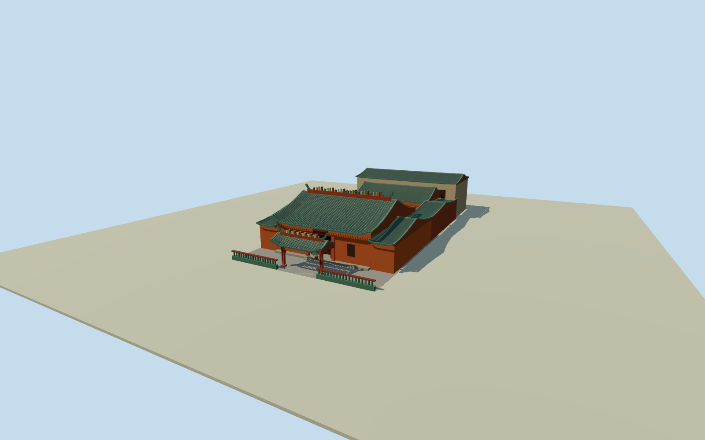

# Kuala Lumpur Guan Di Temple

Cantonese temple frontage with green glazed tile roofs, orange-red walls and an ornate gate on Jalan Tun H.S. Lee.

Authoring state: **review-in-qa.json**. Current completion evidence is in [qa.json](qa.json) and the [completion ledger](../../../../qualla-structures/batches/qualla-003.PROGRESS.md).

- [Kuala Lumpur Guan Di Temple](https://qualla.com/kuala-lumpur-guan-di-temple/)

The February 2007 Qualla photo establishes the street façade, recessed hall, roof, gateway and front fence. Roof ridge figures, plaques and door ornament are simplified at this scale.

The named map polygon represents the full property. Hall depths, the interior court and rear elevations are approximations. The two-storey rear building is documented by the temple association.

The original composite field includes a steep elevation anomaly across the property, consistent with nearby building returns. The dated placement opens terrain only within the paved site boundary. Original source elevations are retained and independently viewable. The modeled thresholds and adjoining street grade remain approximate.

Build: `node content/worldgen/source/places/w2/w28/kuala_lumpur_guan_di_temple/models/generate-guan-di-temple.mjs`. Add `--check` to verify exact regeneration. 10598 triangles; 5 materials; no embedded photographs.
