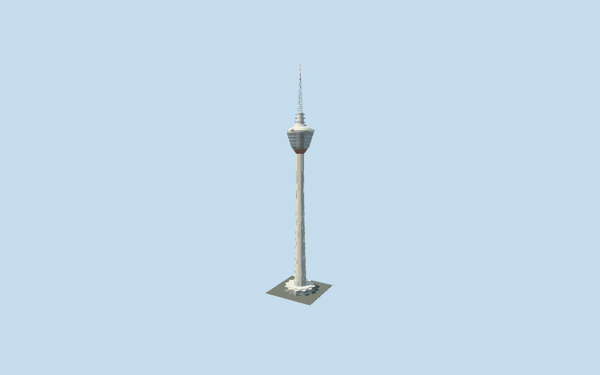

# Kuala Lumpur Tower

Complete parabolic ribbed KL Tower with rose scalloped soffit, triangular framed observation glazing, open skydeck/two glass boxes, three transmitter galleries and421m antenna above exact mapped star lobby.

## Evidence and reconstruction

Published dimensions and reconstructed details are separated in spec.json. Primary references:

- [Reference](https://www.cidb.gov.my/wp-content/uploads/2022/11/CIDB-full-layout-12.54pm-lowres_compressed.pdf)
- [Reference](https://storage.ebrochures.malaysia.travel/storage/IDB_PDF_MTG_EN.pdf)
- [Reference](https://www.menarakl.com.my/)
- [Reference](https://girleatworld.net/kl-tower-review/)
- [Reference](https://thetravelauthor.com/kl-tower-kuala-lumpur-your-complete-guide/)
- [Reference](https://www.openstreetmap.org/way/589740576)

No third-party geometry, photograph or bitmap texture is embedded. Shared surface graphs come from the central library; vertex tints carry model colors. Glazing uses PBR materials; transparent surfaces are declared per model.

## Model and axes

60,832 triangles; 116,328 vertices; 6 material groups; 4,921,560 bytes. Native bounds: -29.924, 0.000, -29.885 to 29.922, 421.000, 29.882. Source hash: `sha256:1dd774694cd6fb2d46bacc216fe507f5fa0a62f576614ce25d43f5501632ec77`.

{"up":"+Y","longitudinal":"+X east/southeast in mapped star frame","front":"+Z southwest arrival sector; exact doorway unverified","origin":"Ground-contact star-plan center; independent shaft center retained"}

The geographic proposal uses exact-QID OpenStreetMap evidence. Map-derived orientation and estimated architectural details require real-site visual review; preview eligibility is distinct from geographic/fidelity approval. Map attribution: © OpenStreetMap contributors, ODbL-1.0.

## Reproduce

Run `node packages/worldgen/scripts/generate-signature-towers.mjs --ids=kuala_lumpur_tower` (or add `--check`). The generator preserves manually edited masters by checking their baseline hashes. Import through the standard authored-model workflow with optimization disabled; then capture all QA cameras, including shared-surface views.

## Pending work

- Complete medium-fi tower comprises mapped star lobby, parabolic ribbed shaft, rose scalloped muqarnas soffit, five widening observation bands with triangular exterior frames, open sky deck and two suspended glass boxes, stepped roof, three transmitter galleries and open lattice/red-white antenna to421m. Original91444-triangle detailed recipe remains unchanged and reproducible. CIDB construction publication supplies24.5m ground diameter,13.6m upper diameter at261.6m,317.16m concrete end and86m antenna; observation276m/skydeck300m from current official tourism/operator information. Ring datums, exact facade/soffit pattern, roof profile, rib counts, skybox supports and fine equipment are reconstructed from primary construction and first-hand photographs. Box outward bearings64/196degrees carry6degree uncertainty and are not surveyed landmark centerlines. Ground lobby glazing is original reconstruction; exact tower door position is unverified, independent off-footprint main-entry node provides only southwest arrival-sector context. Separate parking complex, low pedestrian mall, rainforest, interior and basement are outside tower bundle. No copied photographs used as textures. Shared painted-metal rose finish approximates actual painted soffit. Glazing uses opaque PBR for office head and alpha PBR for skybox/guard; exact reflections, panel joints, nighttime lights and signs omitted. Actual hillside grade and physical-device performance unmeasured.

This bundle follows the medium-fi standard. Medium-fi appearance and geographic fit are reviewed separately. Hash-bound visual acceptance is recorded separately after capture inspection.
