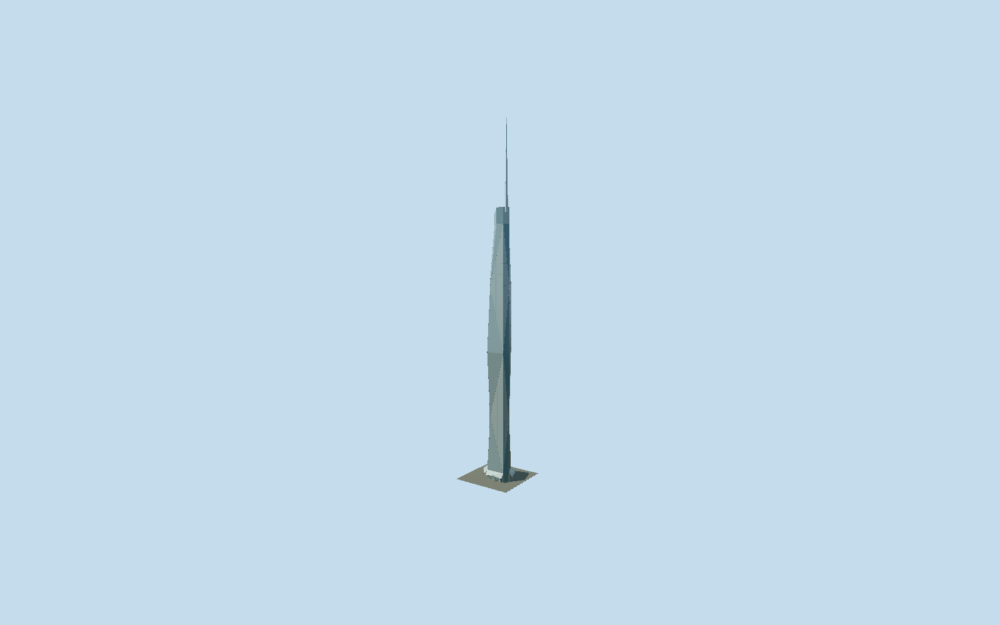

# Merdeka118

The Kuala Lumpur crystalline supertall with its clipped diamond plan, independently glazed triangular facade planes, offset angular160.4m spire, stepped observation crown, dense floor/panel grid and folded metal atrium canopies with V supports.

## Evidence and reconstruction

Published dimensions and reconstructed details are separated in spec.json. Primary references:

- [Reference](https://www.pam.org.my/images/publications/am2025/37-1/AM37.1.pdf)
- [Reference](https://revistaalconpat.org/index.php/RA/article/download/808/2360/)
- [Reference](https://www.arup.com/en-us/projects/merdeka-118/)
- [Reference](https://news.samsungcnt.com/en/features/engineering-construction/2024-09-merdeka-118-an-engineering-marvel-and-the-worlds-second-tallest-building/)
- [Reference](https://www.openstreetmap.org/way/645604854)
- [Reference](https://www.openstreetmap.org/way/629116778)

No third-party geometry, photograph or bitmap texture is embedded. Shared surface graphs come from the central library; vertex tints carry model colors. Glazing uses PBR materials; transparent surfaces are declared per model.

## Model and axes

9,953 triangles; 26,005 vertices; 4 material groups; 1,058,424 bytes. Native bounds: -33.268, 0.000, -31.475 to 38.322, 678.901, 31.415. Source hash: `sha256:d72a82c71980f0136975e6bf0faddd3c5e6984905895c7ea8f5de6c5cdd1de59`.

{"up":"+Y","longitudinal":"+X northeast minimum-rectangle edge","front":"+Z southeast","origin":"Ground-level mapped tower frame at entry datum"}

Fresh OSM API on 2026-10-10 confirms exact Q7969454 whole outline 645604854 and nine unchanged separately retained parts. Heading 1.546962847249 retained: native +X northeast, +Z southeast. Native +X follows the minimum rectangle edge, not the long diamond diagonal. Separately mapped mast 629116778 is at the northeast crown corner; independently reprojected mast center corroborates native [30.18,15.74]. PAM completed north elevation, sky-lobby plan and site aerial corroborate the clipped diamond, Stadium Negara east and Stadium Merdeka south. Whole map height now 678.9 m agrees with engineer/architect; 2021 part heights 125/250/375/500/550/635 m remain construction evidence only. Ground Y=0 is tower entry level. Accept 2 m footprint / 1 degree reconstruction allowance; automatic replacement disabled. Mall, park and below-grade terrain are separate context.

## Reproduce

Run `node packages/worldgen/scripts/generate-signature-towers.mjs --ids=N0178` (or add `--check`). The generator preserves manually edited masters by checking their baseline hashes. Import through the standard authored-model workflow with optimization disabled; then capture all QA cameras, including shared-surface views.

## Pending work

- Original 144834-triangle, 17086960-byte detailed master remains exactly reproducible from the unchanged world-tower recipe. Reviewed source/four levels preserve clipped diamond plans, every inclined triangular facade plane, lower 509.2 m mechanical deck, stepped 509.5/518.5 m crown and northeast angular spire to 678.9 m. Continuous planar glass backings with long clipped mullion strips replace independent framed cells. Near levels retain diagonal ribs, folded closed canopies/V supports, travertine-toned lobby columns, roof plant and observation bands. Skyline reduces pane/rail/plant details; district/street aggregate panes/floors. Glass tint contrast is reduced for medium-fi without flattening facet geometry. Source master uses independently linked published plans/photos; facet ring offsets, pane pitch, canopy projection and mast section widths remain reconstructions. Arup/PAM/main engineer text agree on 678.9 m; engineer abstract says 679.9 m and is documented as a conflicting figure. Three shared 256 px graphs, four near draw groups, opaque glass and zero images. Grey foundation reuses tinted travertine graph. Separate mall, landscape/water park, stadiums, below-grade parking, interiors, moving equipment, aircraft obstruction/night LEDs and tenant lettering are excluded. 1.5 / .75 / .3 / .1 m finite-probe allowances exclude omitted thin mullions/rail bars. No physical-device or surveyed grade claim.

This bundle follows the medium-fi standard. Medium-fi appearance and geographic fit are reviewed separately. Hash-bound visual acceptance is recorded separately after capture inspection.
