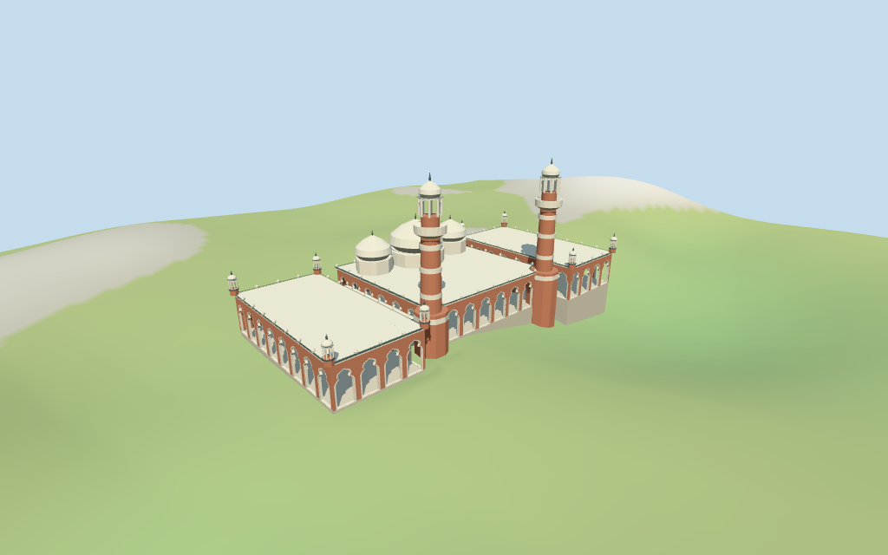

# N0474 — Sultan Abdul Samad Jamek Mosque

Reviewed 2026-10-18 for its declared medium-fi exterior and approximate map fit. Wing roles, facing, dome heights and precise grade joins remain estimates.

## Exterior and shared materials

Inspected 11 current portable renders, including the retained 1024×640 summary. Three white onion domes, twin banded brick minarets with open lantern caps, cream cusped arcades, flat pale roofs, low connectors and selected corner chhatris are present. Rear windows have opaque panes visible from both sides. Galleries are open and unfurnished. Fine ornament, flags, signs, umbrellas and detached service structures are omitted.

Inspected 11 current shared-material/geographic-flat views, including the placement overlay. Five existing 256² graphs provide longformat brick, raw/coursed limestone, lime plaster and painted metal; six merged roles include local opaque glazing. Metric UVs and linear tints; no embedded images or unique atlas. Graphs are read once and model geometry is disposed on eviction. All 74 surrounding host buildings remain separate. The flat placement image checks pose and replacement; the retained DEM fixture supplies approximate ground contact.

## Browser levels

| Level | Triangles | Bytes | Draws |
| --- | ---: | ---: | ---: |
| skyline | 928 | 99272 | 1 |
| district | 3946 | 387328 | 6 |
| street | 14264 | 1374140 | 6 |
| closeup | 23406 | 2356908 | 6 |

**486,600 bytes for initial skyline plus district**, plus five existing shared 256² graphs. Six merged roles; no embedded images.

Inspected 27 current medium-fi views: Economy/High, noon/late light, street/block/skyline, silhouette, six details, four matched LODs and four transitions. Three domes, twin striped minarets and arcade rhythm persist at distance. Skyline keeps broad openings and solid small pavilion proxies. District keeps additional framed bays and open tall lanterns. Street restores coarse cusps; closeup restores more lobe points, inner frames, parapet points and small open chhatris. Distant trim was simplified to restore arch openings within budget. Whole portable views retain both complete minarets; shared detail cameras may crop their tips. Physical-device/full-city timing remains pending.

## Placement and limitations

Q1143296 retained reference point and current Jamek Mosque POI35184852806566 agree on the river-confluence mosque. Named Jamek Mosque POI identifies the central three-domed prayer hall at the river confluence. The contiguous main hall,its two attached side wings and low connecting strips are included;three roof parts and two32 m minaret plans refine that same structure. Nearby detached service/ablution buildings,river works,station,shops and courtyard pavement stay host content. No exact Wikidata-tagged footprint was retained;this is a current named-POI/map correspondence and approximate fit. Heading 1.257641544721982 rad follows the minimum-area rectangle of the central hall;positive Z faces the mapped minaret/entry side. Facing,part membership and roof partitions remain approximate visualization judgments. Standard Protomaps20261014 and Mapzen/USGS viewer extractN0474;datum 26.481141919133147 m. 398 footprint samples span -3.10996714439948 to 8.006455090112862 m. Floor 4.682367379640158 m is the median of 216 outer samples plus0.28 m. Footings sample edges at<=2.5 m. Replacement and preview seating use only seven selected body/connector/minaret masks;roof parts are already above the main body. Courtyard,detached service buildings,rivers,embankments and adjacent shops remain host content. Thresholds,stairs,water edges and exact grade joins are unverified. Independently reproduced all ten current plans / 86 vertices, the named mosque point and unchanged height tags. Seven selected body/connector/minaret masks preserve courtyard and river ground. All 504 footprint checks and 1,218 FrontSide probes pass. Those probes cover open galleries, opaque rear windows on both sides, roofs/floors, both 32 m tower tips, open lanterns and seated foundations. The 398 footprint, 216 outer and 513 seated preview samples reproduce the 16-bit terrain fixture. Three outside points remain outside the masks.

Individual Sultan Abdul Samad Jamek Mosque: current central hall,attached side wings and low connecting galleries;three pale onion domes,paired banded brick minarets with open lantern caps,cusped cream-trimmed arcades,flat roofs,coarse parapets and selected corner chhatris. Brick/cream rhythm,domes and minarets carry identity. Detached service buildings,river works,station,courtyard paving,umbrellas,planting,flags,signs,fine ornament and furnished interiors are excluded. Shapes and membership remain approximate. Retained height/width/length facts are empty. Current PMTiles tags are 8 m for main/side bodies,5 m for connecting strips,11 m for three roof parts,and32 m for both minarets. All tags remain unchanged. The 11 m roof-part tags have unresolved component/datum semantics and guide the estimated drum tops;white onion shells and finials rise to19.1 m for the central dome and17 m for the side domes. This is a picture-guided estimate above nominal mapped parts,not a measured height. Both minarets retain32 m estimated total height;small corner chhatris and parapets are estimated. The retained record supplies a reference point only, not an exact Wikidata-tagged footprint. Current named-POI correspondence, selected connected plans, facing, wing roles and dome shapes are approximate. The 11 m roof-part tags are preserved separately from the estimated onion shells and finials. Historical/current ornament, exact dome dimensions, thresholds, stairs, courtyard/river edges, interiors and engineering are unverified.

## Verification

49 current views inspected; 1,218 FrontSide probes; 504 footprint checks; six zero-error/zero-warning Khronos validations. Current model, source, input, material, capture and placement hashes agree. Raw map controls and the 16-bit terrain fixture reproduce. Source/placement checks, scene validate/sim30, selected LOD layout and Biome pass. Bulk captures stay ignored.

Source: sha256:82754988d8f6a4c89bf65cefecf6d835c8333891fd918b61a3642b7b81a6aa50

Runtime: sha256:477ea8c8b6a2b9528bc9301c7ccfd4a40bc5536107697cf7bdd5b10466881618

Input: sha256:8e1a1dc712a1106409de65028b2cee0aec5546af2c934e7943244ce365483f2c

Commands: targeted generate-additional-landmarks/import-next-1000-models/generate-landmark-lods/register-landmark-previews --ids=N0474; source/placement --check; capture-next-1000-models --reflections --antialias --fit-shadows; capture-landmark-library --reflections --adaptive-clipping --bounded-placement; capture-medium-fi --ids=n0474_sultan_abdul_samad_jamek_mosque --reflections; scene validate/sim30; selected LOD layout; Biome. Existing package builds reused.

## Inspected picture references

[Balon Greyjoy (uploader;no machine-readable author listed) — 2019-08-22](https://commons.wikimedia.org/wiki/File:20190822_Sultan_Abdul_Samad_Jamek_Mosque-1.jpg). CC0-1.0. Daylight near exterior: red brick and broad pale bands,tall paired tower vocabulary with cream balconies and open lantern cap,small corner chhatris,white onion domes,cream cusped arch frames,flat dark roof edging and pale parapet points. Fine decorative lattice,flags and loudspeakers are omitted.

[Alexey Komarov — 2019-03-24](https://commons.wikimedia.org/wiki/File:Sultan_Abdul_Samad_Jamek_Mosque,_Kuala_Lumpur,_24_March_2019.jpg). CC-BY-SA-4.0. Whole mosque at night from the river confluence: three principal pale domes with a larger central bulb,paired minarets,low repeating front arches and small edge pinnacles. This distant view establishes setting and broad silhouette only;night lighting,mist,signage and neighboring towers are not part of the model.
