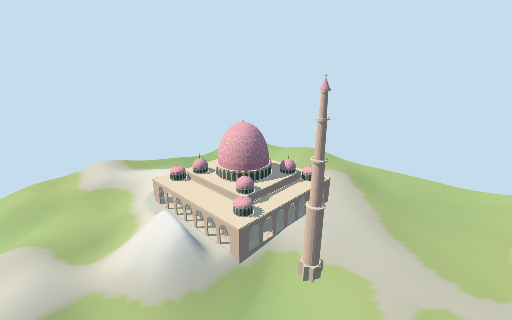

# Putra Mosque

Individual Putra Mosque: mapped square waterfront podium and separate minaret base,pink pointed arcade facades and upper abstract lattice fields,stepped pale main hall,windowed drum,large pink dome with original coarse cream diamond rhythm,eight smaller domed pavilions,bronze finials and tall tiered minaret. Historic arabesque artwork,calligraphy,furnished interiors,adjacent causeway/circulation buildings,landscaping and water surface are excluded.

## Evidence and reconstruction

Published dimensions and reconstructed details are separated in spec.json. Primary references:

- [Reference](https://commons.wikimedia.org/wiki/File:PutraMosque_Front.JPG)
- [Reference](https://commons.wikimedia.org/wiki/File:Putrajaya_-_Putra_Mosque.jpg)

Six existing shared256² sandstone,raw limestone,ceramic tile,marble,painted metal and bronze graphs;seven merged roles including local opaque glazing. Metric UVs,linear tints,no embedded images or unique atlas. Coarse diamond/grid rhythm is original abstraction and does not copy historic tile/calligraphy artwork.

## Model and axes

20,608 triangles; 61,824 vertices; 7 material groups; 2,477,228 bytes. Native bounds: -49.071, -14.762, -48.823 to 86.285, 94.990, 48.817. Source hash: `sha256:a2a17bacda29ade07d5d1d0828d674987dbe4d1e2d404792f4f1863edf41c89b`.

{"x":"estimated entry/minaret towardpositive X","y":"up","z":"cross axis"}

Standard Protomaps20261014 /Mapzen-USGS viewer extractN0478;datum 44.59826109734036 m. 1035 selected-pad samples span -13.885171013491355 to 14.905460220561409 m. Floor -5.0104090150284195 m is the median of 155 main/minaret edge samples plus0.3 m. The synthetic review terrain seats the pads with an8 m apron and8 m outer blend to prevent coarse3.6 m fixture interpolation from burying the facade;this is an illustrative fixture adjustment,not measured shoreline grading. Two masks cover the complete selected podium and minaret base;independent mapped hall/pavilion parts explain filling the retained relation inner rings. Footings sample grade at<=3 m. Host water and circulation remain separate. Exact waterline,pier depth,stairs,thresholds,retaining levels and foundation engineering are unverified.

## Reproduce

Run `node packages/worldgen/scripts/generate-additional-landmarks.mjs --ids=N0478` (or add `--check`). The generator preserves manually edited masters by checking their baseline hashes. Import through the standard authored-model workflow with optimization disabled; then capture all QA cameras, including shared-surface views.

## Pending work

- Retained Q2344561 /relation8518759 identity,anchor,undirected axis,10-vertex outer envelope and all five inner rings remain unchanged in the source record. Current named mosque POI and podium ring share id52776566652007. The large inner ring is occupied by separately mapped hall geometry and the four circular rings by mapped domed pavilions;they are not treated as open courtyards. All current parts fully inside the retained outer envelope,plus three explicit minaret controls,are selected. The minaret sits outside the square podium. Front facing,rooftop roles,arcade/lattice rhythm and exact vertical datums remain approximate. Adjacent circulation/causeway buildings remain host content.
- All original selected height/min_height tags are retained verbatim. The 25 m hall,33 m drum,63 m main shell,29/35/40 m inner pavilion stages,19/25/30 m outer stages and100 m minaret control the visualization nominally. The dome receives an estimated4 m finial. The separate65 m ring part,84 m center pole and60/35 m tower parts have unresolved component/datum semantics;their values are preserved without forcing incompatible geometry. Tier positions,spire profiles,arcades,eaves and precise stage dimensions are estimates,not surveyed measurements.
- Standard Protomaps20261014 /Mapzen-USGS viewer extractN0478;datum 44.59826109734036 m. 1035 selected-pad samples span -13.885171013491355 to 14.905460220561409 m. Floor -5.0104090150284195 m is the median of 155 main/minaret edge samples plus0.3 m. The synthetic review terrain seats the pads with an8 m apron and8 m outer blend to prevent coarse3.6 m fixture interpolation from burying the facade;this is an illustrative fixture adjustment,not measured shoreline grading. Two masks cover the complete selected podium and minaret base;independent mapped hall/pavilion parts explain filling the retained relation inner rings. Footings sample grade at<=3 m. Host water and circulation remain separate. Exact waterline,pier depth,stairs,thresholds,retaining levels and foundation engineering are unverified.
- Front and overview pictures guide color,roof,turret,arcade and minaret vocabulary. Fine lattice,arabesques,inscriptions,interiors,current condition,exact waterfront level,foundation engineering and physical-device/full-city performance are unverified or abstracted.

This bundle follows the medium-fi standard. Medium-fi appearance and geographic fit are reviewed separately. Hash-bound visual acceptance is recorded separately after capture inspection.

## Additional geographic data

©OpenStreetMap contributors;Protomaps;Mapzen/USGS terrain.
