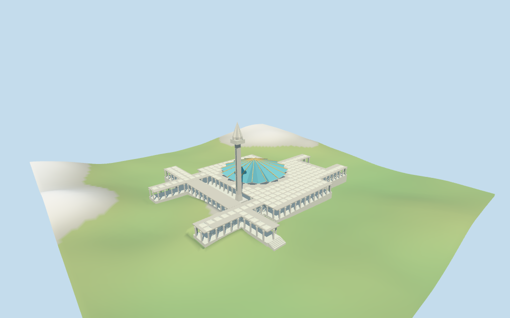

# national_mosque_of_malaysia — National Mosque of Malaysia

Reviewed 2026-10-17 for the stated medium-fi exterior and approximate map fit. Current map controls supply the main outline, raised connector, minaret base and coarse 11/73 m heights. Internal architecture and detailed terrain fit remain reconstructed.

## Exterior and shared materials

Inspected all 11 final portable views, including a curated 1024×640 preview. The turquoise sixteen-point folded umbrella has warm pale ribs and a pale underside over the sixteen-sided hall. Low mapped ranges carry repeated shallow white caps and open columns. The tall square minaret has a projecting platform and pleated pointed cap. Corrected the approach treads so they descend outside the podium and lowered the hall camera to show its original coarse diamond screen rhythm and wood-colored door. Screens, roof caps, ribs, tower subdivisions and facade spacing simplify the photographed exterior. Fine star-screen artwork, lettering, fixtures, gardens, reflecting pools and furnished interiors are omitted.

Inspected all 11 final shared-material/geographic-flat frames, including the north-up control overlay. Five existing shared 256² stucco, marble, membrane, mosaic tile and plain wood graphs serve six merged roles including local opaque blue-grey glazing. Metric UVs, linear colors and zero embedded images or copied photographs. Every model graph is read once; eviction disposes model geometry and restores the host ground. Original anchor and heading remain fixed. The main, connector and tower controls are retained exactly. Flat terrain checks transforms, replacement and texture integration; it hides the low approach below its plane and does not validate the real ground grade. The source DEM fixture separately shows the approach steps.

## Browser levels

| Level | Triangles | Bytes | Draws |
| --- | ---: | ---: | ---: |
| skyline | 619 | 65268 | 1 |
| district | 1839 | 186596 | 6 |
| street | 7947 | 793652 | 6 |
| closeup | 9087 | 882572 | 6 |

**251,864 bytes for initial skyline plus district**, plus the shared texture library. Five existing 256² graphs, six merged roles, zero embedded images.

Inspected all 27 final medium-fi views: Economy/High, noon/late light, street/block/skyline distances, untextured silhouette, six details, four matched LODs and four transitions. Also inspected the matched skyline at full size. Skyline 619 retains the folded cyan roof, low articulated campus and square minaret while omitting ribs, roof-cap grid, fine columns/screens and approach treads. District 1839 restores ribs, sparse caps/columns and steps. Street 7947 restores the dense cap grid and original coarse screen rhythm; closeup 9087 refines cap profiles. Initial skyline plus district 251864 bytes, plus shared textures; one/six draws. The cap grid visibly densifies between district and street. The transition fixture renders static matched levels; it does not establish a timed physical-device test. Some roof, soffit and shadow faceting remains visible. Terrain and procedural neighbors are test fixtures.

## Placement and limits

Retained exact main way 585264338 / Q1356818 is viewer building 35184957353170. Current main outline has 28 raw vertices; raised connector 35184494096317 and minaret base 35184494096321 each have four. Original anchor and heading retained. Positive X approximately north-northeast; positive Z east-southeast. The three mapped controls form one connected campus with two gaps. Their union outer outline controls the paved podium and terrain cutout; the two gaps remain open above that podium. Main roof/hall center [4.3,-6], cap grid, column spacing and entry division are picture-led visualization estimates. Minaret center is the actual mapped tower bounding-box center, not an arbitrary offset. Separate surrounding ranges, gardens, fountains, streets and city remain host content. Six estimated approach treads extend to local Z=82.15, about 6 m beyond the mapped southeast roof edge. The three raw control outlines and cutout remain unchanged. Normal viewer DEM datum 48.907660164596706 m; working floor -7.960260800153894 m is the median of 291 outside-perimeter samples at 1 m offset plus 0.3 m. 1621 raw campus samples span -13.699828863443386..0.8451278515805143 m. Adaptive perimeter footings support a paved podium over the union outer outline, including its two open roof gaps. Preview terrain seats that outer outline and 1.5 m margin. Exact street approach, garden walls, stairs, reflecting-pool levels and present terrain joins remain unverified. Independently reproduced three current controls and all 36 raw vertices, then their one-polygon union with 29 outer vertices and two roof gaps of four/five vertices. Model paving covers the ground cutout beneath those gaps. All 252 renderer footprint checks pass across six GLBs: all three selected map buildings are covered and 39 exterior host buildings stay separate, including building 35185589665168. All 132 FrontSide checks pass for blue roof facets, pale undersides, tower cap/platform, open connector, two paved courts and six approach treads in the five detailed files. Reproduced 1621 raw terrain samples, 291 outside-perimeter samples and 1531 seated preview points. Exact reflecting-pool surfaces, approach threshold, retaining walls, garden/street grades and present terrain joins remain unverified.

Individual medium-fi National Mosque of Malaysia campus: broad turquoise sixteen-point folded umbrella roof, pale rib bands and sixteen-sided hall, low mapped roof ranges with repeated shallow white square caps, open colonnades and courts, raised entry canopy and tall square pale minaret with pleated pointed cap. Exact three map controls retained; internal roof/hall layout, facade rhythms and component heights remain estimates except current 11 m main and 73 m tower total tags. Five existing shared 256² graphs serve six merged material roles. Four separate browser LODs. No bespoke photography, inscriptions, fine screen artwork, neighboring mausoleum/ranges or furnished interiors. Current main building height tag is 11 m; current tower height tag is 73 m; the connector has layer=1 and no height. Retained main building has three levels and no numeric height. Main low roofs use 11 m above the working floor. Picture estimates: raised podium 2.4 m; sixteen-sided prayer hall eaves 11 m; folded umbrella valleys 11.5 m, projecting tips 15.3 m and central hub 26 m. The blue roof therefore rises above the coarse main building height tag, explicitly reconstructed from pictures. Tower total height respects 73 m, with estimated slender square shaft to 56 m, projecting square platform to 59 m and pleated pointed white cap/finial to 73 m. The 73 m tag does not establish those internal levels. Entry stairs, canopy fingers, roof caps and lattice proportions are approximate; no surveyed engineering or interior claim. Two useful actually inspected Commons overall photographs plus one supplementary screen detail guide the exterior. Main height 11 m, tower height 73 m and connector layer 1 are current map facts. The taller folded roof, hall center and all internal tower tiers are estimates. The original retained main facts and signed axes remain unchanged. Three raw building outlines establish placement and scale; they do not establish the exact internal cap grid, colonnade spacing, entry approach or roof geometry. The standard DEM is coarse and the source fixture seats a working floor. Exact finish, structural engineering, unseen interiors and physical phone/tablet/laptop performance remain unverified.

## Verification

49 current views inspected; 132 FrontSide probes; 252 actual renderer footprint checks; six Khronos checks with zero errors or warnings. Source/runtime/input/LOD/frame/material/report/placement hashes agree. Three exact controls and their union reproduced; terrain samples and 16-bit heightmap reproduced. Source --check, placement --check, scene validate/sim30, LOD layout and recipe/registration Biome pass.

Source: sha256:88d319d583d2078eafc8d6c4ef64d152237baf34bfa9ec353f8e872d4ebae990

Runtime: sha256:8f641f7451e66dd55115a2e354ab47f8ceab74953b908a6596113a6f44ecbe5b

Input: sha256:d2c196f01e6049de727c8db36a1574e30417506b88421f4f4a4939515f0767b8

Commands: generate-additional-landmarks/import-structure-models/generate-landmark-lods/register-landmark-previews --ids=national_mosque_of_malaysia; targeted generator and placement --check; capture-structure-models --reflections --antialias --fit-shadows; capture-landmark-library --reflections --adaptive-clipping --bounded-placement; capture-medium-fi --ids=national_mosque_of_malaysia --reflections; selected LOD check; scene validate/sim30; recipe/registration Biome. Bulk captures stay ignored. Previous full source checkpoint great_mosque_of_aleppo–great_mosque_of_xi_an; next kocatepe_mosque–great_mosque_of_al_nuri.

## Inspected picture references

[Jorge Láscar — 2014-04-20](https://commons.wikimedia.org/wiki/File:Masjid_Negara_and_its_minaret_(18790212558).jpg). CC-BY-2.0; viewed only. Inspected complete 960×640 street exterior. Slender square pale minaret with projecting platform and tall folded pointed cap; broad low entrance canopy with fingered/scalloped edge and thin columns, raised approach and blue folded roof behind. Exact lettering, gardens, fixtures and fences not copied.

[Philip Nalangan — 2006-01-03](https://commons.wikimedia.org/wiki/File:Majid_Negara_Kuala_Lumpur_Malaysia.jpg). CC-BY-4.0; viewed only. Supplementary complete 960×719 detail of open geometric concrete star screen and pale broad beams. No full roof or plan control. Original coarse diamond screen rhythm is an approximation; fine screen artwork not copied.

[Pangalau — 2023-03-29](https://commons.wikimedia.org/wiki/File:Masjid_Negara_view_from_Kuala_Lumpur_Tower_2023.jpg). CC-BY-SA-4.0; viewed only. Inspected complete 960×652 elevated complex. Turquoise sixteen-point folded star umbrella roof with pale warm ribs, pale scalloped hall edge, slender minaret to the left and low white roof ranges with repeated shallow square caps. Open courts and columns visible. Detailed positions, heights, roof profiles and current finish remain estimates. Background city, separate roofed buildings and trees not copied.
