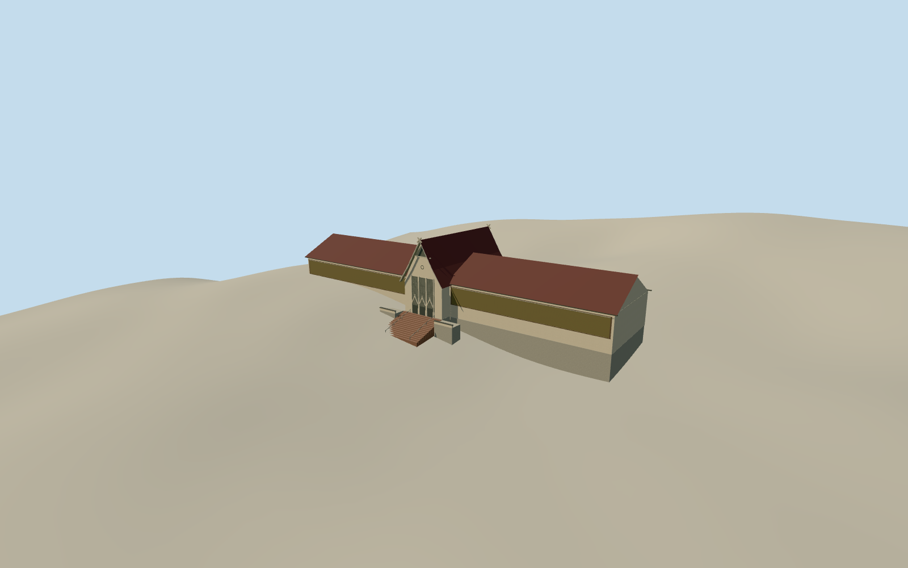

# National Museum of Malaysia

Muzium Negara in 2008 with red roof wings, a steep crossed-apex entrance gable, screened bays, mosaic fields and broad stairs.

Authoring state: **review-in-qa.json**. Current completion evidence is in [qa.json](qa.json) and the [completion ledger](../../../../qualla-structures/batches/qualla-003.PROGRESS.md).

- [National Museum of Malaysia](https://qualla.com/national-museum-malaysia/)

The long footprint, steep crossed-apex gable and entrance hierarchy are documented. Exact heights, rear details and the stair threshold are visual estimates. The museum’s published central dimension is not labeled by axis.

The original 256-meter elevation field is unchanged. Apparent side grades may include vegetation or later work and are approximations of the 2008 conditions.

The original artworks in the two mosaic panels are outside scope. The model uses a generic tiled surface for their position and material. The separate palace, railway station and museum collection are outside scope.

Build: `node content/worldgen/source/places/w2/w28/national_museum_malaysia/models/generate-museum.mjs`. Add `--check` to verify exact regeneration. 1199 triangles; 6 materials; no embedded photographs.
