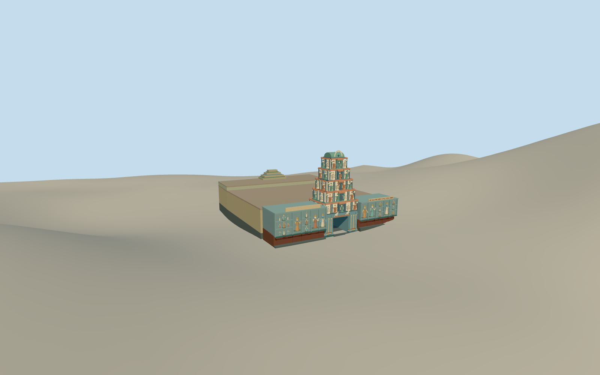

# Sri Mahamariamman Temple, Kuala Lumpur

The Kuala Lumpur temple’s five-tier gopuram, blue sculpted street walls and low attached hall.

Authoring state: **review-in-qa.json**. Current completion evidence is in [qa.json](qa.json) and the [completion ledger](../../../../qualla-structures/batches/qualla-003.PROGRESS.md).

- [Sri Mahamariamman Temple, Kuala Lumpur](https://qualla.com/sri-mahamariamman-temple-kuala-lumpur/)

The four CC0 photographs date the street appearance to February 18, 2007 and guide the entrance tower, colors and two flanking blue façades.

The tower height and stepped silhouette follow the photographs and the tourism authority’s dimensions. Individual painted figures, panel decoration, lettering and unseen roof sections are simplified.

The mapped outline anchors the temple and approximate rear hall. The original elevation field is preserved. The coarse urban surface rises along the northern side, so contact and visible plinth heights are approximate.

Build: `node content/worldgen/source/places/w2/w28/sri_mahamariamman_temple_kuala_lumpur/models/generate-sri-mahamariamman.mjs`. Add `--check` to verify exact regeneration. 18790 triangles; 6 materials; no embedded photographs.
