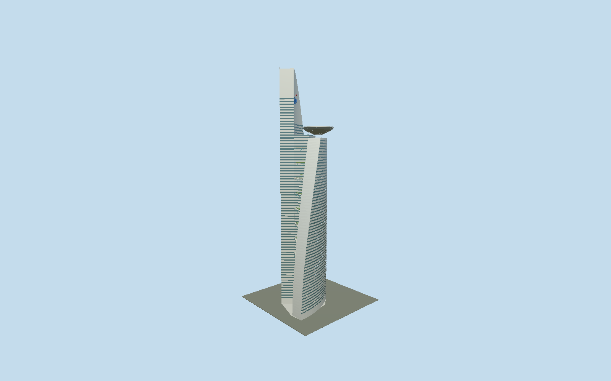

# Telekom Tower

310m Menara Telekom with two separately curved and tapered office wings, central core,22 planted open sky gardens, bowed cyan transfer trusses, recessed ribbon glazing with three metal sunshade blades, clad antenna sail and the236m bowl-supported helipad.

## Evidence and reconstruction

Published dimensions and reconstructed details are separated in spec.json. Primary references:

- [Reference](https://www.hijjas.com/menara-telekom/)
- [Reference](https://www.hijjas.com/beginnings/)
- [Reference](https://www.skyscrapercenter.com/building/menara-tm/453)
- [Reference](https://jtkconsult.com.my/the-practice/publications-2/)
- [Reference](https://www.scribd.com/document/1062607466/KGN-Joint-Paper-Oct-Telekom-HQ-1997)
- [Reference](https://www.openstreetmap.org/way/154443873)
- [Reference](https://www.openstreetmap.org/way/594858890)

No third-party geometry, photograph or bitmap texture is embedded. Shared surface graphs come from the central library; vertex tints carry model colors. Glazing uses PBR materials; transparent surfaces are declared per model.

## Model and axes

62,786 triangles; 185,234 vertices; 4 material groups; 7,424,560 bytes. Native bounds: -51.051, 0.000, -39.797 to 34.460, 310.000, 40.103. Source hash: `sha256:2aae42bedae507f38567b6aaa66306341b15960054b8e50d6f831fddda429676`.

{"up":"+Y","longAxis":"+X southeast in mapped envelope frame","shortAxis":"+Z southwest; antenna north-northwest of helipad"}

Fresh2026-10-10 exactQ118214 mapped envelope154443873, helipad594858890 and four roof/core parts match all six preserved raw rings. Original anchor[101.665831363,3.116224206] and heading-0.826793628665 retain native+X southeast and +Z southwest. Engineer1997Figure1/3 independently inspected establish opposing16m curved wings around rectangular core and triangular garden voids. The northwest endpoint of roofpart594896248 lies NNW of the independently mapped helipad, signing tall antenna wing versus shorter helipad end; architect completed-building photograph corroborates asymmetry. Least-squares mapped helipad center[-1.56475214,18.07995944], radius21.155892951m, maximum radial residual.26347012m matches modeled center[-1.5,18] and21.2m grating edge within.35m; circle fitting is not survey precision. Projected roof outline is evidence, not a footprint to extrude. Traced lower wing feet/core/canopy are approximate architectural reconstruction; aggregate outer-envelope differences up to12m are accepted, not claimed submeter site fit. Garden datum heights/planting and portal are unsurveyed; groundY0 approximates entrance apron. Independent door bearing is not claimed. No footprint replacement. Southwest conference pavilion, adjacent buildings, basements, interiors, roads and site landscaping excluded.

## Reproduce

Run `node packages/worldgen/scripts/generate-signature-towers.mjs --ids=telekom_tower` (or add `--check`). The generator preserves manually edited masters by checking their baseline hashes. Import through the standard authored-model workflow with optimization disabled; then capture all QA cameras, including shared-surface views.

## Pending work

- Original buildTelekom remains unchanged and reproduces1458078triangles/127149832bytes. Independent reviewed source preserves both separate curved/tapering16m office strips, central closed core, all22 open triangular sky gardens, cyan bowstring trusses, planted terraces, separate310m clad antenna sail/TM strokes and236m six-level helipad bowl. Original3.5m facade course rhythm is reconstructed, not a literal55-floor count. Near16segments replace56curve segments; continuous recessed glass ribbons and projected flat sunshade leading edges replace repeated closed beam shells. Three sampled shade strips per course approximate original four blade edges. End walls retain continuous ribbon glazing without narrow original mullions. Garden plants use simple faceted shrub masses/eight three-segment fronds, not individual pinnae. Two-sided vertical strip trusses approximate solid steel profiles; they remain visibly open, not filled walls. Helipad72sides/open radial fall-protection grating/four concentric strips and landing H/ring replace144sides/round torus tubes; ground portal retained. Skyline omits portal, glass detail, truss/guard profiles, palms, heli ring/grating and TM glyph, but keeps22 open garden slabs/green strips, distinct curved wings, closed core,12-sided bowl/disk/H and310m piers. District restores portal, ribbon glazing, TM strokes,16-sided open heli grating and two-segment bowstrings; street restores7m coarse courses, four-segment bowstrings/two-frond palms and32-sided helipad. Close-up restores3.5m courses/flat mullions/shade strips,12-segment bowstrings/guards/eight-frond palms,72-sided helipad/ribs. Original wing curves and independent heli center retained; canopy, lower-wing feet, taper, garden levels/planting and intermediate modules are reconstructed. Painted-metal graph approximates ACP; vertex-tinted shared granite approximates paving, shrubs and trunks within draw budget; opaque palette approximates glass and translucent palette vestibule side walls. Physical-device/dense-city timings, curb survey and global geometric error bounds unmeasured.

This bundle follows the medium-fi standard. Medium-fi appearance and geographic fit are reviewed separately. Hash-bound visual acceptance is recorded separately after capture inspection.
