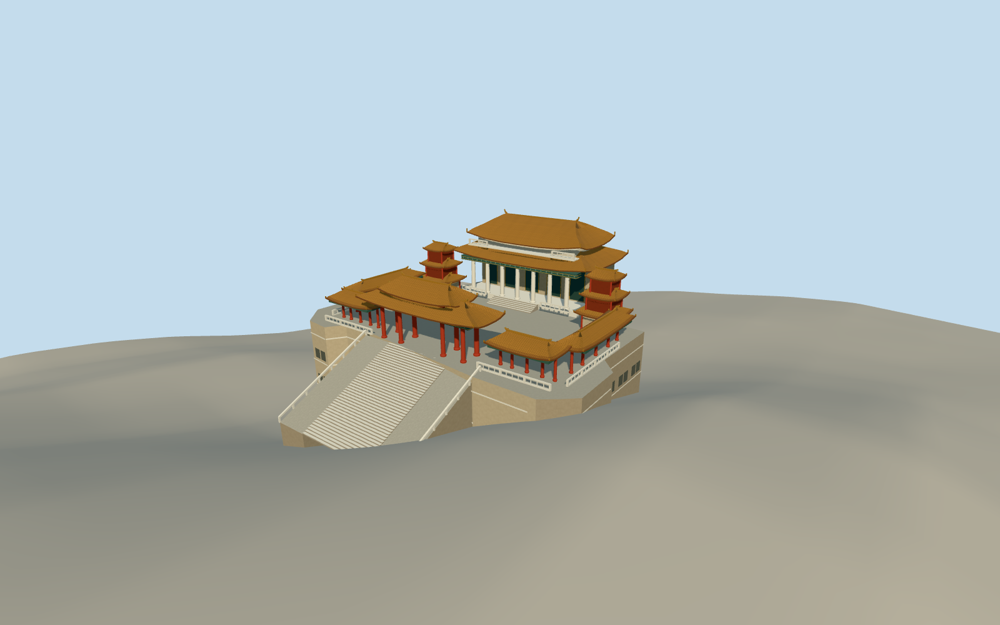

# Thean Hou Temple

Raised white hilltop temple court with red columns, swept amber roofs, a double-tier gate and flanking galleries.

Authoring state: **review-in-qa.json**. Current completion evidence is in [qa.json](qa.json) and the [completion ledger](../../../../qualla-structures/batches/qualla-003.PROGRESS.md).

- [Thean Hou Temple](https://qualla.com/thean-hou-temple/)

The source photographs are dated to December 2007. The viewer uses December 1 as the representative date.

The named footprint controls the aggregate complex and the gate and court photographs control its identifiable upper structures. Individual roof tiers, deck levels, lower podium openings and rear elevations are reasonable estimates.

Glazed tile, green beams, railings and rising ridge tips are modeled. Fine animal figures, painted ornament and inscriptions are simplified. The surrounding landscape and adjacent unnamed building are context.

Independent original elevations are preserved. Photographs and the elevation grid establish approximate registration rather than exact surveyed thresholds.

Build: `node content/worldgen/source/places/w2/w28/thean_hou_temple/models/generate-thean-hou-temple.mjs`. Add `--check` to verify exact regeneration. 18846 triangles; 6 materials; no embedded photographs.
