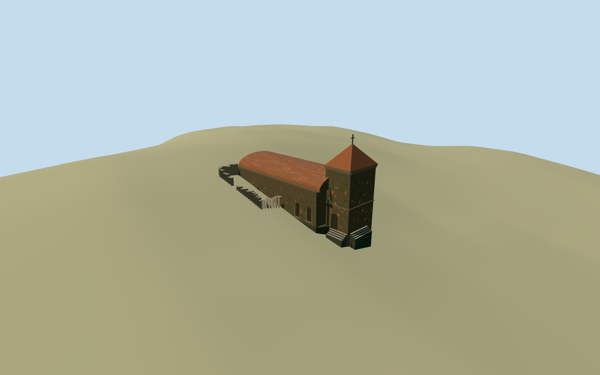

# Church of Mount Bokor

The weathered Bokor plateau church with its curved concrete roof, square bell tower, stone steps, cross and roofless side ruin.

Authoring state: **review-in-qa.json**. Current completion evidence is in [qa.json](qa.json) and the [completion ledger](../../../../qualla-structures/batches/qualla-003.PROGRESS.md).

- [Church of Mount Bokor](https://qualla.com/church-of-mount-bokor/)

The model reflects the 2020 condition and the permanent features confirmed in 2026, before restoration. Estimated roof, wall and tower heights follow proportions in the exact photos.

The weathered stone and orange moss are represented procedurally. Interior furnishings, plant growth, temporary work and proposed restoration are outside scope.

The hill grade comes from the original regional open elevation source. Individual rocks and adjacent landscaping are simplified.

Build: `node content/worldgen/source/places/w3/w3c/church_of_mount_bokor/models/generate-church-of-mount-bokor.mjs`. Add `--check` to verify exact regeneration. 2735 triangles; 6 materials; no embedded photographs.
