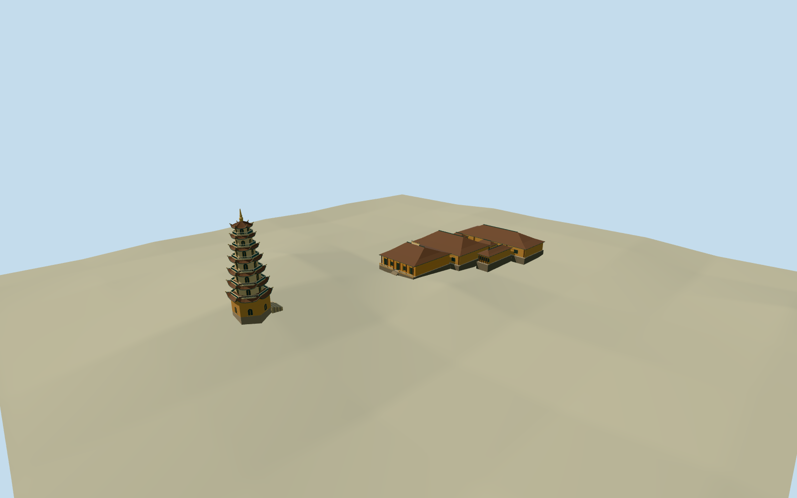

# Giác Lâm Temple

The linked ochre halls of Giác Lâm under broad clay tiles, and the pale seven-tier Bảo tháp Xá Lợi with raised glazed corners and open balconies.

Authoring state: **review-in-qa.json**. Current completion evidence is in [qa.json](qa.json) and the [completion ledger](../../../../qualla-structures/batches/qualla-004.PROGRESS.md).

- [Giac Lam Temple](https://qualla.com/giac-lam-temple/)

The current main hall, two linked rear hall rows and relic stupa constitute the exterior model. The map controls the hall envelope and the two open wells. Roof ridge heights and rear service elevations are estimates.

The current relic stupa stands on the left of the entrance and south of the halls. Exact stupa outline and surveyed coordinates are unavailable in the native map, so its location and width are approximated within the precinct.

The scale-appropriate exterior omits individual tombs, interior features, sculpture inscriptions and the subsidiary monastic outbuildings.

Build: `node content/worldgen/source/places/w3/w3g/giac_lam_temple/models/generate-giac-lam-temple.mjs`. Add `--check` to verify exact regeneration. 18685 triangles; 7 materials; no embedded photographs.
