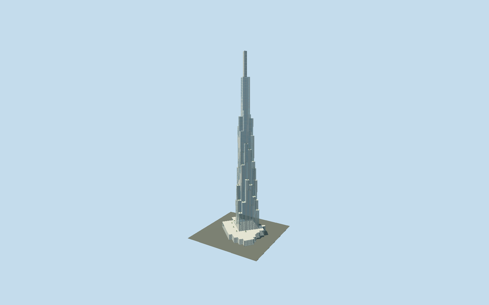

# Landmark 81

Complete stepped blue/silver bamboo-cluster tower and mapped podium, selected terrace gardens, glazed atrium and independent offset rectangular461.2m spire.

## Evidence and reconstruction

Published dimensions and reconstructed details are separated in spec.json. Primary references:

- [Reference](https://www.atkinsrealis.com/~/media/Files/A/atkinsrealis/download-centre/en/case-study/landmark-case-study.pdf)
- [Reference](https://group.schindler.com/en/media/stories/landmark-81.html)
- [Reference](https://www.openstreetmap.org/way/622296615)

No third-party geometry, photograph or bitmap texture is embedded. Shared surface graphs come from the central library; vertex tints carry model colors. Glazing uses PBR materials; transparent surfaces are declared per model.

## Model and axes

12,691 triangles; 30,439 vertices; 5 material groups; 1,251,252 bytes. Native bounds: -61.617, 0.000, -59.581 to 61.619, 461.200, 59.585. Source hash: `sha256:5df7fb08209641eee2750d3b32d4d003f4f19e1aaa7b083717e786d84c1fc069`.

{"up":"+Y","longitudinal":"+X east/southeast in podium frame;9m grid aligned to mapped mast rectangle","front":"+Z south/southwest; exact entrance unverified","origin":"Ground-contact mapped podium center, separate tower center retained"}

The geographic proposal uses exact-QID OpenStreetMap evidence. Map-derived orientation and estimated architectural details require real-site visual review; preview eligibility is distinct from geographic/fidelity approval. Map attribution: © OpenStreetMap contributors, ODbL-1.0.

## Reproduce

Run `node packages/worldgen/scripts/generate-signature-towers.mjs --ids=landmark_81` (or add `--check`). The generator preserves manually edited masters by checking their baseline hashes. Import through the standard authored-model workflow with optimization disabled; then capture all QA cameras, including shared-surface views.

## Pending work

- Complete medium-fi bundle comprises36 stepped9m-grid tower modules, silver vertical edges, blue glazing/floor rhythm, independently mapped461.2m rectangular spire, planted selected terraces and retail podium with reconstructed glazed atrium. Original72981-triangle detailed recipe remains unchanged/reproducible. Architect56-page study explicitly describes Scheme Design and supplies6x6 nine-metre concept and461.2m/389.2m design elevations;389.2m is historical design, not asserted as current observation datum. As-built engineer/equipment supplier photographs confirm stepped bamboo massing and rectilinear spire; owner2019 opening describes79–81 observation near400m. Fabricator supplies roughly61m steel spire; reviewed400.2m nominal support/61m assembly is reconstructed from total, not a surveyed roof elevation. Individual36 setback heights, module gaps, roof gardens, mast cladding/grid and podium atrium are approximate, guided by design drawings/completed photographs. Retail terrace pools, exact entry locations, rooms, hotel interiors, basement and surrounding park omitted; this is a tower/podium bundle. Projected courtyard/atrium roof position follows earlier scheme and may differ as-built. Shared metal/concrete/stone textures plus component tint; glass PBR, no copied photographs embedded. Selected planting is stylized geometry; night dynamic lighting, true grade and physical-device performance unmeasured.

This bundle follows the medium-fi standard. Medium-fi appearance and geographic fit are reviewed separately. Hash-bound visual acceptance is recorded separately after capture inspection.
