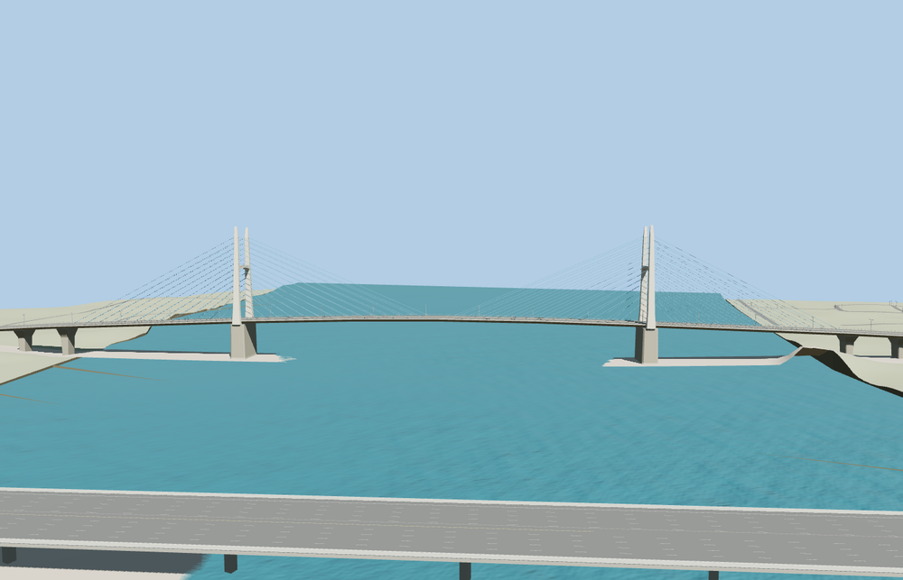

# Mỹ Thuận Bridge

Two tapered concrete H-frames rise over the Tiền River. Their arched crossbeams and pointed tips frame the roadway, with blue stay fans at both deck edges. Repeating concrete piers support the long graded approaches.

The named OSM bridge way 908825447 and the dual QL1 traces locate the original crossing southeast from Tiền Giang toward Vĩnh Long. The viewer preserves the separate Mỹ Thuận 2 motorway crossing. Twelve roadway seam samples pass at every tier with a maximum height difference of 2.5 cm. The original crossing returns when the model fails to load. Native terrain, water, approach ramps and lower paths remain.

The 33,516-triangle source rebuilds byte for byte. The first two runtime tiers total 340,012 bytes. Six GLBs validated and 36 current views were inspected.

Mapped carriageway traces fix the axis and bearing locations. The H-frame tower dimensions, pier stations and deck grades are exterior-photo estimates. The viewer grade at the Tiền Giang landing is fitted to the standard elevation surface.

Rebuild with `node packages/worldgen/scripts/generate-my-thuan-bridge.mjs`. Append `--check` to compare exact bytes. Use `--ids=my_thuan_bridge` for targeted import, LOD, placement and readiness.
