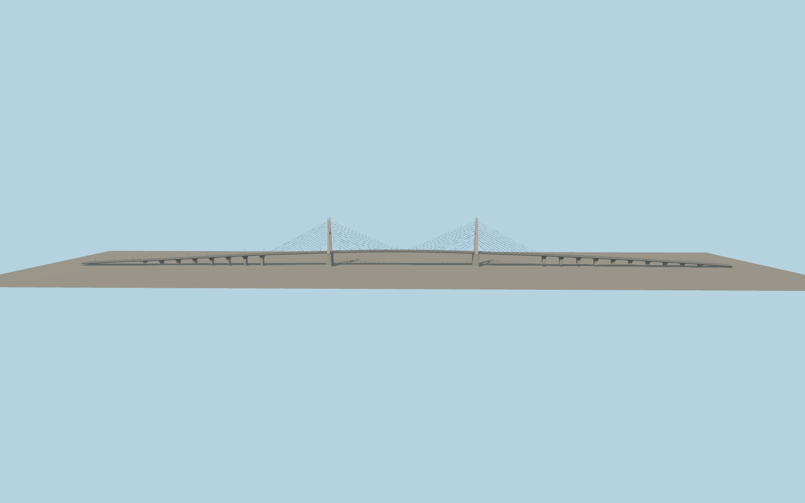

# Mỹ Thuận Bridge

Two tapered concrete H-frames rise over the Tiền River. Their arched crossbeams and pointed tips frame the roadway, with blue stay fans at both deck edges. Repeating concrete piers support the long graded approaches.

Run `node packages/worldgen/scripts/generate-my-thuan-bridge.mjs` to rebuild the source master. Append `--check` to compare the exact bytes. Use `--ids=my_thuan_bridge` for targeted import, LOD generation and placement.

Mapped carriageway traces fix the axis and bearing locations. The H-frame tower dimensions, pier stations and deck grades are exterior-photo estimates.

The viewer grade at the Tiền Giang landing is fitted to the standard elevation surface.

Original geometry follows the repository license. Map data is © OpenStreetMap contributors under ODbL-1.0 via Protomaps. Terrain samples are described in terrain-grid.json. Ordinary pictures stay local and are not redistributed or used as textures. Current acceptance is recorded in qa.json.
