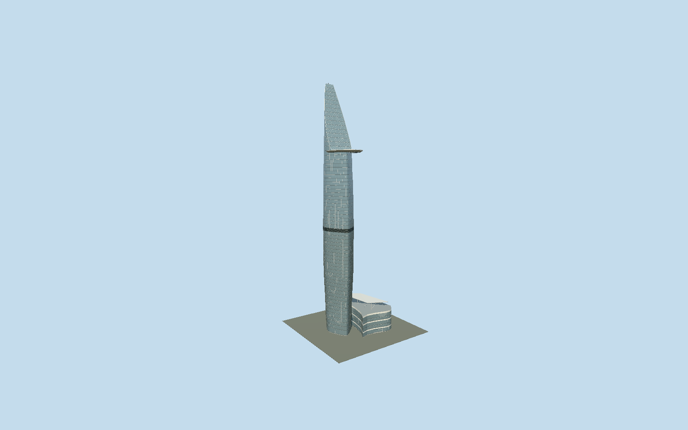

# Bitexco Financial Tower

Carlos Zapata’s asymmetric lotus tower with a floor-by-floor curved glazed exterior, inclined upper leaf, projecting oval helipad with open safety net, lower mechanical belt and glazed retail podium under its floating steel canopy.

## Evidence and reconstruction

Published dimensions and reconstructed details are separated in spec.json. Primary references:

- [Reference](https://bitexco.com.vn/en/project/bitexco-financial-tower/)
- [Reference](https://www.turnerconstruction.com/projects/bitexco-financial-tower)
- [Reference](https://www.skyscrapercenter.com/building/bitexco-financial-tower/736)
- [Reference](https://www.mfacade.com/projects/bitexco-financial-tower/)
- [Reference](https://www.lera.com/bitexco-tower)
- [Reference](https://doi.org/10.1051/e3sconf/20183301018)
- [Reference](https://www.openstreetmap.org/way/804073951)
- [Reference](https://www.openstreetmap.org/way/1231606415)

No third-party geometry, photograph or bitmap texture is embedded. Shared surface graphs come from the central library; vertex tints carry model colors. Glazing uses PBR materials; transparent surfaces are declared per model.

## Model and axes

58,344 triangles; 170,322 vertices; 4 material groups; 6,834,552 bytes. Native bounds: -36.480, 0.000, -31.603 to 36.058, 264.000, 33.640. Source hash: `sha256:f05f424c0e7bd546c85ecb0d6a9de101607cd0fd6a98083a1a177bfff7b7c946`.

{"up":"+Y","longitudinal":"+Z toward the mapped southern helipad projection","front":"+X toward the retail podium","origin":"Exact-QID mapped outer envelope center; tower center is offset to the west of the podium."}

Fresh2026-10-10 exactQ638512 parent804073951 and allfive constituent rings retain unchanged raw coordinates against independently preserved original evidence. Anchor[106.704428701,10.771853631]/heading.737047755372 retains native+X northeast bearing47.769degrees toward irregular retail podium and native+Z southeast bearing137.769degrees toward mapped landing square1231606415. Independent raw upperroof parts1222241872/74 and southwest lens/northern cusp sign the direction; mapped roof-direction127.5degrees is a coarse tag, not substituted for geometry. The original parent local scaled-Mercator outline matches within.002m rounding; podium and landing square are separately projected using original local tangent conversion. Parent outline includes upper projections and must not be extruded as a floorplate. Published262.5m architectural,264m tip,240.1m occupied,191.4m helipad and68floors retained; raw269m part height rejected as conflicting. Turner178m refers to49th-floor observatory, not helipad; registry181.9m observatory is separate. Turner52nd/registry55th helipad floor labels disagree;191.4m height governs. Six retail levels follow facadeengineer and mappedpodium. Lens controls, inclinedcrown, canopy/entrance/detail dimensions remain reconstructed from primary completed photos without dimensioned plans. Y0 is approximate local apron; no surveyed curb grade/cadastral accuracy or footprint replacement. Underground floors/interiors/tenant branding and temporary constructionexcluded.

## Reproduce

Run `node packages/worldgen/scripts/generate-signature-towers.mjs --ids=N0209` (or add `--check`). The generator preserves manually edited masters by checking their baseline hashes. Import through the standard authored-model workflow with optimization disabled; then capture all QA cameras, including shared-surface views.

## Pending work

- Original bitexcoStudy.build is preserved unchanged and reproduces315402triangles/27557128bytes. Separate reviewed master retains smooth asymmetric lotus lens/inward lower20-floor taper, inclined upper leaf clipped exactly at floor crossings and closed cut curtain, narrow top roof/equipment264m, projecting closed oval191.4m helipad with separate soffit/ribs/open safety net/H/circle/mapped landing square, independent six-level irregular podium with continuous recessed entry and asymmetric floating canopy/supports. Flat projecting facade strips replace repeated closed mullion/transom beam uploads; near72spaced curve samples versus original104, original floor datums and.65m spandrels retained. Near pad64sides/32net supports/two perimeter crosswires/one intermediate radial replaces160/80/four/three. Street48curve samples/everythird floor plus explicit profile datums/48pad sides/coarse net and3m podium bays; district32curve samples/profile datums/24pad sides/coarse net/6m podium bays; skyline20curve samples/profile datums/16pad sides/closed pad and underside without markings/net or fine facaderhythm. District omits flat horizontal frame strips; skyline uses four canopy uprights and merges the thin podium foundation into its ground wall. All retain the109.291–112.907m dark mechanical belt, crown closure, asymmetrical mappedpodium, entrance void and canopy supports. Canonical limestone approximates both pale podium stone and foundation, paintedmetal carries dark recess/soffit, stainless handles and opaqueglass palette retain four near groups. Glass panel unique cutting is represented by varying floor/lens geometry, not6000individual hardware assemblies. Podium canopy/entry dimensions, crown profile, equipment and exact safety-net construction unsurveyed; hidden interiors/underground and branding excluded. Physical-device/densecity timings and global simplification bounds remain unmeasured.

This bundle follows the medium-fi standard. Medium-fi appearance and geographic fit are reviewed separately. Hash-bound visual acceptance is recorded separately after capture inspection.
