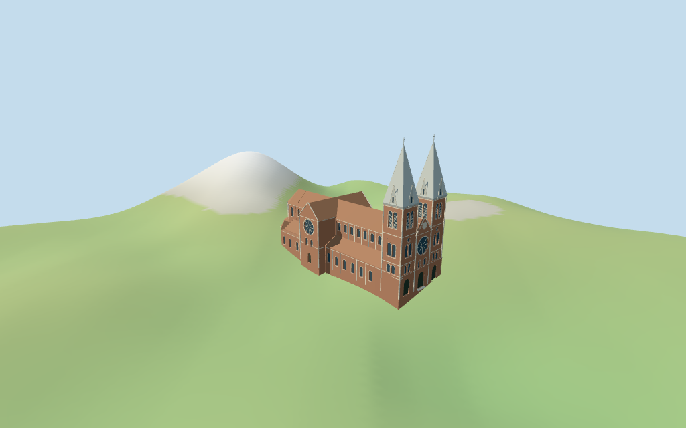

# N0410 — Saigon Notre-Dame Basilica

Reviewed2026-10-16 against current source/runtime bytes. Accepted for the stated medium-fi exterior and approximate horizontal fit. All heights/fine profiles are estimates. Exact ground/site joins remain unverified;the retained coarse urban DEM visibly undulates and buries parts of the rear/northeast base.

## Built exterior

Inspected all11 final portable/source-terrain views,including the1024×640 summary. Individual red-brick Saigon basilica:paired square towers with pale pointed metal spires,dormers and crosses;three-door front with large rose and clock beneath stepped gable;long red-tile nave/low aisles;rose-window transept;continuous choir ridge with polygonal apsidal fan and three lower rear chapel projections. Removed lower windows on tower faces buried by the nave/front and corrected a false valley at the nave/choir roof junction. Fine profiles and exact ground joins remain approximate.

## Shared surfaces and browser levels

Inspected all11 final shared/geographic views. Five existing256² running-bond brick,raw limestone,flat tile,painted metal and plain wood graphs;six merged groups including local blue-grey glazing. Pale shared metal abstracts spire cladding. Linear tints,metric UVs and flat normals;no embedded images,bespoke textures,facade photographs or baked lighting. Graphs read once;unload leaves zero live model geometries. Geographic captures use flat terrain;portable/medium-fi retain the standard DEM.

| Level | Triangles | Bytes | Draws |
| --- | ---: | ---: | ---: |
| skyline | 869 | 52,392 | 1 |
| district | 3,049 | 221,572 | 6 |
| street | 13,063 | 1,041,968 | 6 |
| closeup | 18,845 | 1,468,528 | 6 |

Initial skyline plus district geometry: **273,964 bytes**. Source master **2,265,144 bytes /18,845 triangles**;imported master **2,264,568 bytes**. Shared graph definitions/runtime texture generation are additional. Five shared256² graphs,six groups,zero embedded images.

Inspected all27 final medium-fi views:Economy/High,noon/late,street/block/skyline distances,untextured silhouette,six detail views,four matched whole levels and four transitions. Skyline869 retains twin pale spires/crosses,brick tower pair,central gabled front,long tile nave,transept and stepped apses. District3049 adds shared textures,front rose/portals/clock,coarse round windows and paired belfry fields. Street13063 adds full window rhythm,rose spokes,louvres,cornices/pilasters,dormer profiles and entry steps. Close-up/master18845 refine arches and spire seam ribs. Paris-mansard neighbors are synthetic;physical phone/laptop timing unverified.

## Geographic fit and limits

Anchor **[106.699018856,10.779803253]**,heading **−0.767176969891rad**,approximate3° facing uncertainty. Native+X southeast twin-spire front/Paris Commune Square,−X northwest rear apses/Lê Duẩn Street,+Z southwest. No horizontal rescale.

Retained exact way/801950766 and Q428129 identify Saigon Notre-Dame Cathedral Basilica. Current standard viewer PMTiles whole35185174039598 retains all31 raw outline points and properties,alongside earlier whole/multilingual tags and named POI. Anchor[106.699018856,10.779803253] and heading−0.767176969891rad unchanged;no horizontal rescale. Native+X southeast twin-spire front toward Paris Commune Square/central statue,−X northwest triple rear apse toward Lê Duẩn Street,+Z southwest side. Three matching front,side and rear pictures resolve signed facing,approximate3°. Separate church-related/town buildings,post office,roads,square/statue,trees and vehicles remain host content.

No architectural height tags or independently retained height facts. All vertical subdivisions are picture estimates above floor0.5m:low aisles/rear chapels9.6m with tile crowns12.9–14.4m;upper nave and polygonal choir walls21.3m/tile ridge28m;transept22.1m/ridge29m;central front cornice23.5m/stepped gable29.6m;brick tower bodies35.5m/pale metal square spires57m/crosses59.5m. Doors,round-headed paired windows,rose,clock,belfry louvres,pilasters,dormers and cornices are estimated. These are visualizations,not surveyed heights,restoration records or exact roof/floor datum.

Standard viewer DEM datum17.778270m;selected perimeter-3.62 to6.42m relative to it. Floor0.5m;adaptive masonry footings crossY=0 and extend below retained samples. Coarse terrain is not used to infer precise pavement,entry steps or curbs. Exact surrounding road/square,threshold/step/base contact,altitude and walking remain unverified. No flattening,cutout or road replacement.

Retained exact way/801950766 and Q428129 identify Saigon Notre-Dame Cathedral Basilica. Current standard viewer PMTiles whole35185174039598 retains all31 raw outline points and properties,alongside earlier whole/multilingual tags and named POI. Anchor[106.699018856,10.779803253] and heading−0.767176969891rad unchanged;no horizontal rescale. Native+X southeast twin-spire front toward Paris Commune Square/central statue,−X northwest triple rear apse toward Lê Duẩn Street,+Z southwest side. Three matching front,side and rear pictures resolve signed facing,approximate3°. Separate church-related/town buildings,post office,roads,square/statue,trees and vehicles remain host content. No architectural height tags or independently retained height facts. All vertical subdivisions are picture estimates above floor0.5m:low aisles/rear chapels9.6m with tile crowns12.9–14.4m;upper nave and polygonal choir walls21.3m/tile ridge28m;transept22.1m/ridge29m;central front cornice23.5m/stepped gable29.6m;brick tower bodies35.5m/pale metal square spires57m/crosses59.5m. Doors,round-headed paired windows,rose,clock,belfry louvres,pilasters,dormers and cornices are estimated. These are visualizations,not surveyed heights,restoration records or exact roof/floor datum. Standard viewer DEM datum17.778270m;selected perimeter-3.62 to6.42m relative to it. Floor0.5m;adaptive masonry footings crossY=0 and extend below retained samples. Coarse terrain is not used to infer precise pavement,entry steps or curbs. Exact surrounding road/square,threshold/step/base contact,altitude and walking remain unverified. No flattening,cutout or road replacement. All60 actual viewer-footprint checks cover the selected whole while preserving six nearby host footprints,the front square,rear Lê Duẩn road and southwest roadway. Approximate horizontal fit and Y=0 attachment convention accepted. The coarse urban DEM produces visible ground undulation and burial at the rear/northeast base;exact pavement/curb/threshold/step/base contact,altitude and walking remain unverified. No horizontal rescale,flattening,road replacement or cutout.

Standard viewer DEM datum **17.778270m**,selected perimeter **−3.62 to+6.42m** relative to it;floor0.5m. Footings extend below retained samples. The coarse urban DEM is not a plaza/road survey:visible base burial/undulation is retained rather than inferred as real paving. Geographic captures use flat terrain;portable/medium-fi retain standard DEM. Exact host-ground contact and walking are unverified. No flattening,cutout or road replacement.

## Verification

**49 current frames inspected;580 geometry probes;60 viewer-footprint checks.** Six Khronos validations have zero errors/warnings/images. Targeted source reproduction,scene validation,30-tick simulation and source/import/four-LOD/input/recipe/capture-image/report/shared graph bindings pass. Graphs read once;unload leaves zero live geometries. Next full source checkpoint:N0410–N0427.

Source: `sha256:8accc775decaef8695abcdfd377b2c22fc0d4b22f31868cf97d9541560cafc2e`

Runtime: `sha256:219c94d42111162967a58c8b085a008fd84735f6783a4d6f2834e0ef6b9fb27e`

Input: `sha256:b1585b573ed6b3a1cc6e55457c4b07a58de75377d92d620757b121726da84a40`

Simulation: `sha256:1f582c0d946a591be1752530643a9174bbe6ad7831e67ae07ee78f21087030b9`

Commands:targeted generate/import/LOD/register `--ids=N0410`;generation `--check`;portable reflections/antialias/fitted shadows;shared reflections/adaptive clipping/bounded placement;medium-fi reflections;scene validate and30-tick simulation. Bulk captures remain ignored.

## Inspected references

[Ngô Trung — 2011-11-03](https://commons.wikimedia.org/wiki/File:Saigon_Notre-Dame_Basilica.jpg). CC-BY-SA-3.0. Inspected enlarged front exterior: paired red brick square towers with cream corner/cornice bands,round-headed paired windows and upper louvres,tall pale grey square spires with triangular dormer faces and crosses. Central brick stepped gable has small white clock,large circular rose in arched surround,three ground entrance axes and small paired upper windows. Image has a sepia/pink cast;natural color uses matching side/rear pictures. Foreground statue,plants,people and cars excluded.

[Ottre — 2008-04-06](https://commons.wikimedia.org/wiki/File:Saigon_Notre-Dame_Basilica_Side.JPG). public-domain. Inspected enlarged front/side exterior: natural red brick walls with pale stone bands;dark red tile nave and lower aisle roofs;long paired round clerestory/aisle windows;projecting transept has a high triangular tile gable and large circular rose. Tower belfry faces have paired arched light-colored louvres;metal square spires have triangular dormer fronts. Trees and street furniture partly occlude the base;hidden joins estimated.

[TomW712 — 2014-03-17](https://commons.wikimedia.org/wiki/File:Saigon_Notre-Dame_Basilica_from_Lê_Duẩn_St.jpg). CC-BY-SA-3.0. Inspected enlarged rear/side exterior: elevated polygonal main choir with red hipped tile roof,round-headed tall upper lights and lower small circular fields;three lower polygonal apsidal chapel projections with radial tile roofs and pale corner pilasters. Transept shows large rose and lower paired lights. Nave/choir cornices carry a simple pale arcade;roof ridge fencing and fine ironwork abstracted or omitted by LOD. Temporary banners,trees,cars,people and surrounding town excluded.

## Remaining scope

Individual medium-fi exterior from three inspected matching2011/2008/2014 pictures by Ngô Trung,Ottre and TomW712,plus standard viewer PMTiles/DEM. Exact way/801950766 /Q428129,current whole35185174039598,31 raw points/properties,earlier whole/tags and same-ID multilingual POI retained. No height tags or independent height facts;all vertical partitions,spires/dormers,clock/window/bay/roof/cornice/portal/step profiles are picture estimates or abstractions. Fine carving,clock numerals,stained-glass artwork,iron ridge fencing,interiors/bells,engineering,current restoration/finish and precise road/square/threshold/step/base contact remain simplified,excluded or unverified. Windows,doors and louvred belfry fields are recessed panes/timber;no open-interior/belfry claim. Square/statue,trees,post office and separate town buildings remain host content. No bespoke surveys or redistributed photographs. Physical-device timings remain unverified.
