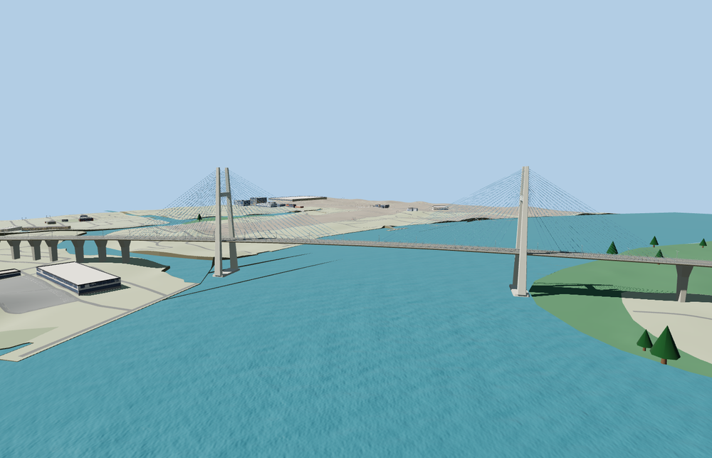

# Phú Mỹ Bridge

Two inward-leaning concrete H pylons rise over the Saigon River. Two blue cable planes hold the six-lane deck between viaducts supported by repeated concrete bents. The model includes roadway markings, guardrails and double-arm median lamps.

The named Cầu Phú Mỹ lane traces locate the northeast crossing from District 7 to the former District 2. Thirty roadway seam samples pass at every tier with a maximum height difference of 4.2 cm. The original crossing returns when the model fails to load. Native terrain, water, the outer approach roads and independent streets remain.

The 43,640-triangle source rebuilds byte for byte. The first two runtime tiers total 365,596 bytes. Six GLBs validated and 36 current views were inspected.

The 380 m main span and 145 m pylons follow the designer’s dimensions. The approach grades, pier stations and cable details use exterior-photo estimates. The deck tapers with the mapped lane corridor. The model shows the 705 m main bridge and the immediately adjoining approaches. Outer mapped approaches continue as native roads.

Rebuild with `node packages/worldgen/scripts/generate-phu-my-bridge.mjs`. Append `--check` to compare exact bytes. Use `--ids=phu_my_bridge` for targeted import, LOD, placement and readiness.
