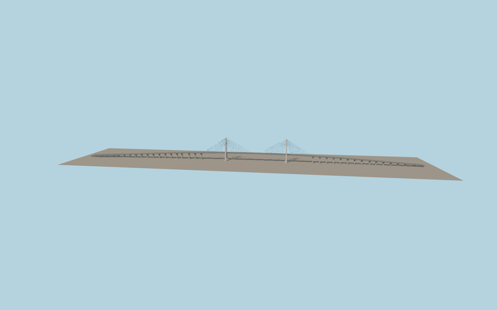

# Phú Mỹ Bridge

Two inward-leaning concrete H pylons rise over the Saigon River. Two blue cable planes hold the six-lane deck between viaducts supported by repeated concrete bents. The model includes roadway markings, guardrails and double-arm median lamps.

Run `node packages/worldgen/scripts/generate-phu-my-bridge.mjs` to rebuild the source master. Append `--check` to compare the exact bytes. Use `--ids=phu_my_bridge` for targeted import, LOD generation and placement.

The 380 m main span and 145 m pylons follow the designer’s dimensions. The approach grades, pier stations and cable details use exterior-photo estimates.

The deck tapers with the mapped lane corridor. The model shows the 705 m main bridge and the immediately adjoining approaches. Outer mapped approaches continue as native roads.

Original geometry follows the repository license. Map data is © OpenStreetMap contributors under ODbL-1.0 via Protomaps. Terrain samples are described in terrain-grid.json. Ordinary pictures stay local and are not redistributed or used as textures. Current acceptance is recorded in qa.json.
