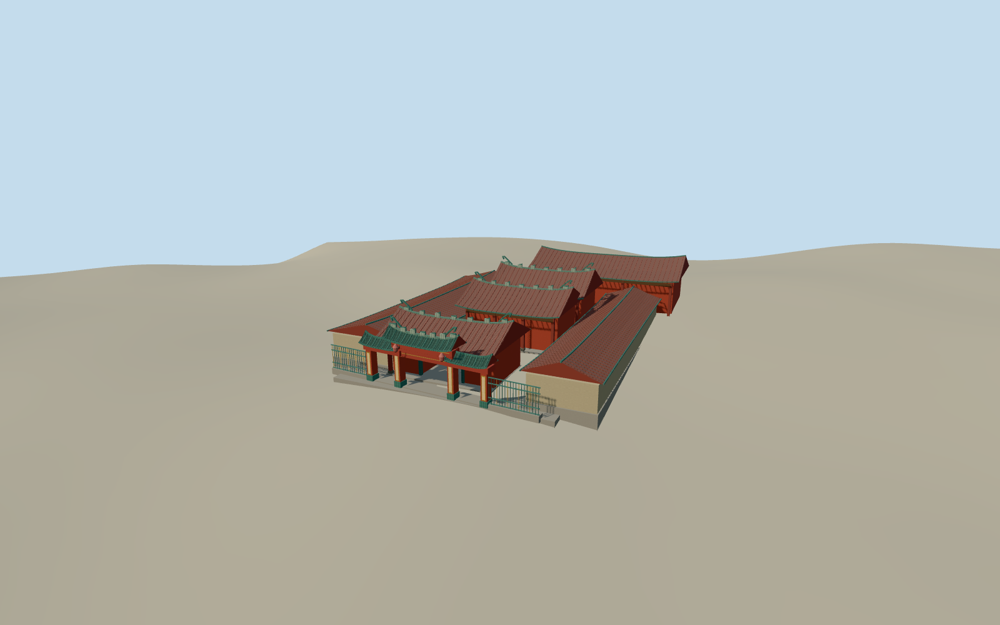

# Quán Âm Pagoda

Quán Âm Pagoda’s red Lao Tu Street gate, curved ceramic roofs, and four halls and side ranges in Chợ Lớn.

Authoring state: **review-in-qa.json**. Current completion evidence is in [qa.json](qa.json) and the [completion ledger](../../../../qualla-structures/batches/qualla-003.PROGRESS.md).

- [Quan Am Temple](https://qualla.com/quan-am-temple/)

The 2008 exterior includes the street gateway, four halls and narrow side ranges. The separate garden across the street and interior artwork are outside the scope.

The exact foreground photograph governs colors, roof curves and the entrance. The heights and ornament of the rear ranges and inscriptions are estimated or simplified.

Build: `node content/worldgen/source/places/w3/w3g/quan_am_temple/models/generate-quan-am-temple.mjs`. Add `--check` to verify exact regeneration. 19602 triangles; 6 materials; no embedded photographs.
