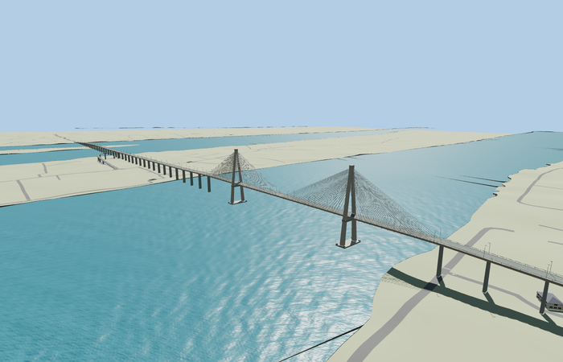

# Rạch Miễu Bridge

Reviewed 2026-10-27. **Scoped original two-channel bridge and island-ramp exterior with approximate native placement complete.**

Inspected62 current frames:11 portable,11 shared-material/geographic,23 medium-fi and17 native. Both original channel crossings, long approach deck, A-shaped pylons/caps/open portals, lower crossbeams, two outside stay planes, broad footings, two-way road with raised edges/open rails, curved lamps, southern box haunches and supported island ramp are present. Opened the main curb/rail at the ramp entry, matched the merge grade and raised the ground landing by0.131m against actual procedural-road crown samples in this same pass. Default scale-based turntables and generic block views show only a thin whole bridge or small viaduct portion; dedicated main-span, driver, ramp and native views carry detail inspection.

Two existing shared256px graphs concrete_plain and metal_painted; three merged semantic groups near and one mean-tinted skyline group. Metric UVs and linear tints; no private/embedded images or photograph pixels. Each graph is read once in native near views. Runtime models use four separate GPU attribute streams.

| Level | Triangles | Bytes | Draws |
| --- | ---: | ---: | ---: |
| skyline | 904 | 77104 | 1 |
| district | 3588 | 289804 | 3 |
| street | 15636 | 1185816 | 3 |
| closeup | 38524 | 3164492 | 3 |

Master 43912 triangles / 5271912 bytes. Runtime 904 / 3588 / 15636 / 38524 triangles; 77104 / 289804 / 1185816 / 3164492 bytes; 1 / 3 / 3 / 3 draws. Initial skyline plus district 366908 bytes. Strict medium-fi budgets pass; physical-device timings are unmeasured.

Original Q2684873 identity resolved with named QL60 Cầu Rạch Miễu / Rach Mieu Bridge PMTiles records35184417572199,35184417572190 and35184937370694. No exact-QID map polygon is claimed. Anchor [106.34334862232208,10.339095307049057], heading1.7706798206929286; +X north-northwest/Mỹ Tho, -X south-southeast/Bến Tre; +Z east-northeast/downstream and island ramp. Mapped route3056.352m includes both bridge/approach sections rather than being rescaled to the older2868m fact; nominal width15m. All9 actual mapped width samples retain paving and model support per LOD within 0.003999948501586914m. Three ramp ground-width samples meet within0.016026m; nine actual ramp-merge width samples follow the authored source surface within0.006535m. Tower stations/sections and vertical grades remain visual approximations, not survey/legal-clearance claims.

All28 fixture buildings and441 independent road records remain. Successful replacement removes6 fully replaced bridge fragments from470 input records, leaving464; failure retains all470. Raw roads, DEM, displayed ground and water remain unchanged. Connected main landing paving is deliberately graded. The curved ramp is fully modeled, but its underlying map transport profile remains near ground; continuous vehicle navigation over the ramp is not claimed. Failed loading keeps original map features; unload releases every model/support geometry. No ground/building cutout is used.

## Reconstruction limits

- Complete original main route across both channels and the intervening island, plus its curved island access-ramp mesh. The newer Rạch Miễu2 crossing is independent; no duplicate landmark is placed there. PMTiles endpoints retain3.056km of bridge/approach plan, rather than rescaling it to the older2.868km combined-length fact. Nominal bridge width15m comes from the existing source facts.
- Main river section near local+625m, approximately504m cable-stayed extent,270m pylon spacing and106m tower tops are visual reconstruction controls, not mapped/surveyed tower points. Tower sections, two cable planes, cable counts, pier rhythm, southern box-girder haunches, underside beams, railings, lamps and footing outlines are simplified from ordinary photos.
- Sea-level source origin0m. The deck rises to roughly41m in the northern main span, with separate lower southern box spans and island approach grade. Landings clear the highest sampled standard Mapzen ground across the road. Water remains the standard viewer result; no surveyed or legal clearance is claimed.
- Island ramp follows the named mapped loop and includes its own supported deck and rails. Its approximate vertical profile connects island ground to the main deck. The underlying map road remains available as transport data; exact driving/navigation grades on this side ramp are not claimed. Independent island roads and buildings must remain.
- Two existing shared256px graphs concrete_plain and metal_painted, three merged semantic groups near, metric UVs and linear vertex tints; no embedded/private images or copied photographs. Far LOD reduces piers/stays/rails, district simplifies southern haunches, near levels retain the ramp, A-portals, full support rhythm and distinctive lamp shapes. Physical phone/laptop timings remain unmeasured.
- The modeled ramp provides a continuous visual surface and open entry; its underlying semantic transport remains at the native ground profile, about26m below the elevated end. No ramp vehicle-navigation grade or traffic simulation is certified.
- The newer named Rach Mieu2 PMTiles crossing lies entirely west of this placement bounds. It is not rendered in this narrow native fixture; the independent geographic-bounds proof prevents this model from replacing it.
- Standard native river stage is about0.65m in the main channel. Coarse banks, pier/footing embedding near shore, approximate southern box sections, incomplete local vegetation/retaining detail and default distant-camera readability remain explicit limitations.
