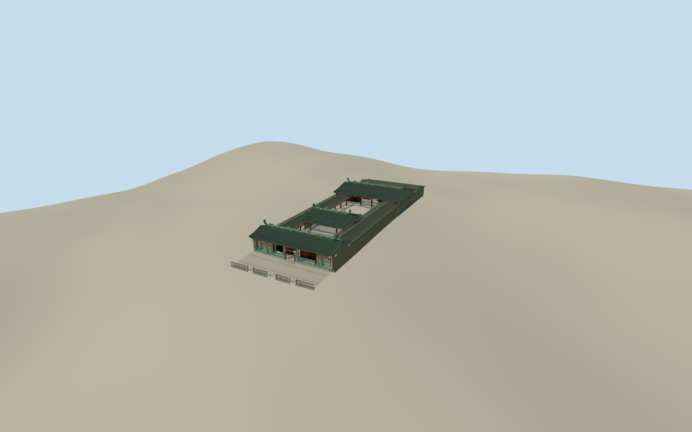

# Thien Hau Temple (Cholon)

Thien Hau Temple in Cholon with a green-grilled entrance, dense ceramic ridge ornament, open courts and three timber halls.

Authoring state: **review-in-qa.json**. Current completion evidence is in [qa.json](qa.json) and the [completion ledger](../../../../qualla-structures/batches/qualla-003.PROGRESS.md).

- [Thien Hau Temple, Cholon](https://qualla.com/thien-hau-temple-cholon/)

The model represents the exterior, axial halls and visible courtyards in September 2019. Individual ceramic figures are simplified and the shrine furnishings are outside the model scope.

The mapped compound and annexes anchor the footprint. Heights and unmeasured roof sections are estimated from the exterior and courtyard views.

The urban source elevation field is kept intact. Contact and interior paving levels use approximate vertical registration.

Build: `node content/worldgen/source/places/w3/w3g/thien_hau_temple_cholon/models/generate-thien-hau-temple.mjs`. Add `--check` to verify exact regeneration. 34513 triangles; 6 materials; no embedded photographs.
