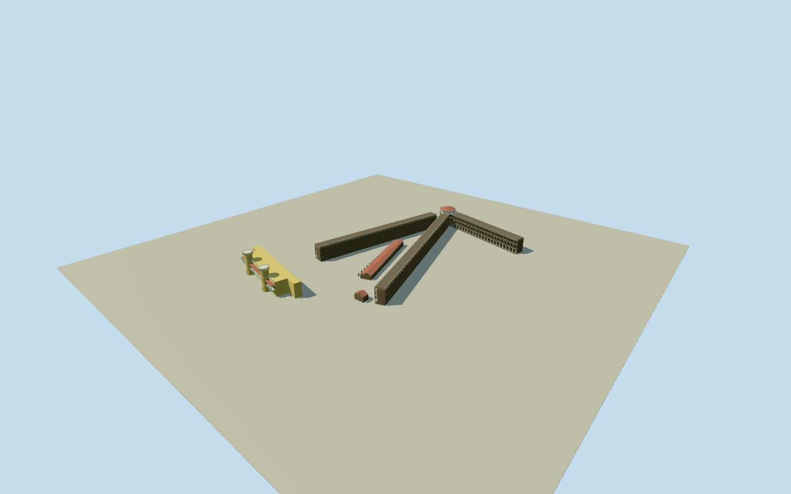

# Cellular Jail

Surviving Cellular Jail architectural ensemble: all three original three-storey radial cell wings and central watchtower, full original entrance/library-museum block with two round flared-crown towers and upper gallery, intrinsic native long workshed and gallows shell. Keep genuine open arched wing corridors/rails and clear entrance passage. Exclude demolished four wings, adjacent G.B.PantHospital, detached modern museum/service structures, parcel/perimeter/landscape/path/ground meshes, sculptures/memorialflame/plaques/signs/flags/vehicles/people, exhibits/interiortortureequipment. Threefulllengthradialwingsfromoriginalnativeoutline, frontfacesonconsistentclockwiseside; otherfacehascellventilators/awnings. Rebuilddarkbrickarcadeswithgenuinevoids/whitegroundpiersandcapsandgreenrailbars, deepcellrowbehind. No flatarcheddecals. Centralgreenopenwatchgallery/redpyramidalroof andochreentrancewithflaredroundcrowns/realmainarch. Survivingexterioronly, notsevenwinghistoricrecreation. Hiddenrear/section/censusbounded.

Authoring state: **review-in-qa.json**. Current completion evidence is in [qa.json](qa.json) and the [completion ledger](../../../../qualla-structures/batches/qualla-002.PROGRESS.md).

- [Cellular Jail](https://qualla.com/cellular-jail/)

ExactCellularJailsiterelation14659654andnamedQ3345501monument1101216326establishidentity. Three-wing/hubwholebuildingway410790247all24originalvertices, fullentrance364631327all10corners, intrinsicWorkshed410790259/Gallows1540295126andwatchtowernode10077716718retained. Unrotatedeast/southnativeframeatwatchtowerpoint. Namedmonumentparcelisnotbuildingfootprint. Currentnativeentrancelevels3tagdoesnotagreewithphotographstwooccupiablefrontlevelsandtallcylindertowers; photo-basedsectionkeptdistinct. No measuredheight/pier/arcadecountmaptags. PrimaryUNESCO/Ministryconfirms3remainingthree-storeywings/centralwatchtower, sevenhistoricwingsnotreconstructed. Threewingpartition/corewidth/arcadepitch/roofheights/towerrounds/entrancepositionsandhiddenrearestimatedfromthreeclearedoriginals. Entrance gallery registered to actual collinear native facade edge3–5, with intermediatevertex4. Original independent approach/terrain remains unchanged.

Quallafirst55families/0conflicts. TwoexactAmbujSaxena2003-12-12publishedselfphotographedPDselfwholeoriginalsplusoneexact2010-04-05PramukhownPDself2288x1712entranceoriginalindividuallyinspected/nativeSHA1matched. Supplementfoundin14-filegatesubcategoryafterbounded200-filemaininventory. QuallaCC0courtesy-nameconflictandtransferredPDuserphotographnotadopted. Allattributionimages/unrelatedregionalimages/modernsculptures/signsunused; no generated/copiedbitmaptextures.

Entirethreewingoriginalnativeoutline/watchtower,originalfullentranceblock,Workshed/Gallowspolygonsretained. Radialwingbodiesaredeepcellrowswithrealopenarchedgalleries,whitegroundpiers/caps,darkbrickbands,thinrailsandrearventilatorhoods. Centralopenwatchgallery/redpyramidalroof,ochreentrance/tworoundflaredcrowns/uppergallery/realmaingateway,ownredshedroofsincluded. Destroyedfourwingsandhospitalnotinvented.

Floorpitch3.4m/wingroof10.42m/central15.3m/gatebody9.7m/towers16.2m,wingpartition/cellcount/archpitch,roundtowercenters±13.8mandradius2.6m, crown/bracket/rail/ventilatorcensusandrearentrancesectionsestimatedfromthreephotographs, notsurveyed. Native3levelentrancetagnotblindlyapplied; phototwofrontoccupiablefloorsandtallroundtowersgovern.

LowerLODsgroupwingarchesandomitfinebars/vents/battlementswhilepreservingallthreefulllengthwings/threefloors/openfrontgalleries/centralwatchtower/entiregatewayandtwoturrets/ownworkbuildings. Nofullhistoricalsevenwingrestoration/interiorexhibits/modernmuseumserviceblocks/parcelwalls/landscape/grounds/paths/art/people/signs/vehicles.

Independent360m91x91/8281heightsand4rawsourceTerrariumtilesretainedunchanged. Fieldextendsintoverydeepcoastalwaterandcontainsurbanreturns; notsurveyedprisonfloorlevels. Allintrinsicfloor/footingsmodeldatumapproximate,flatQAgroundonly; currentlivehostthresholdcontactunverified. PreviewreplaceFootprint=false,nogradingorwholeparcelpad.

Build: `node packages/worldgen/scripts/generate-authored-places.mjs --ids=cellular_jail`. Add `--check` to verify exact regeneration. 63130 triangles; 6 materials; no embedded photographs.
