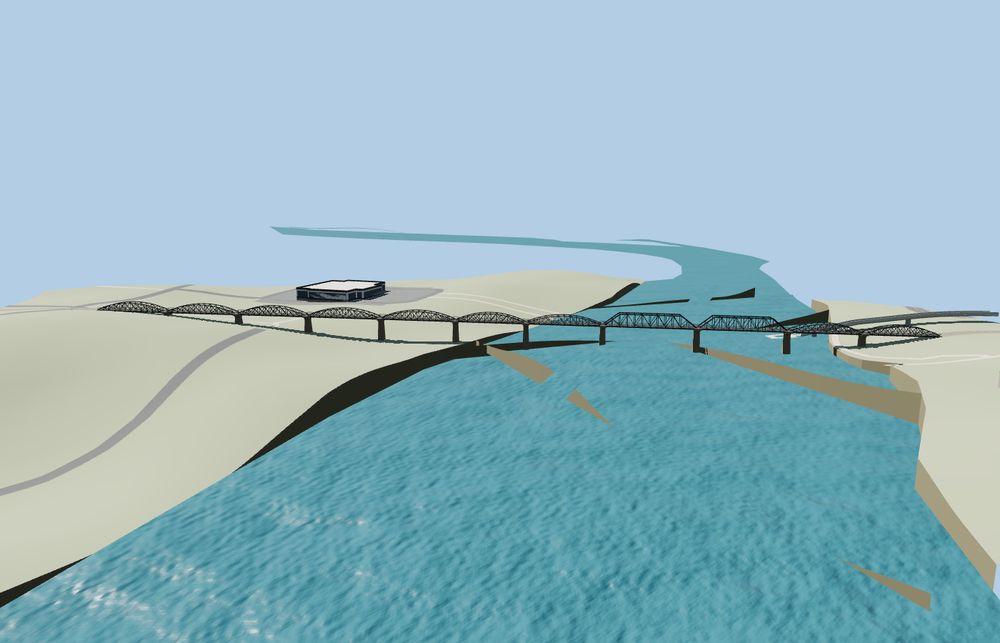

# River Kwai Bridge

Kanchanaburi railway bridge with open black curved trusses, two angular replacement spans, flared concrete piers, a single meter-gauge track, narrow walking plates and pier refuge bays.

The source master has 28,588 triangles. The skyline, district, street, and close-up tiers have 872, 3,904, 14,936, 24,084 triangles. The first two tiers total 392,864 bytes. The close-up tier is 1,910,176 bytes. Six GLBs passed validation and 34 current views were inspected.

All four tiers pass six rail bed joins within 0.15 m and six endpoint height checks within 0.10 m. Eight approach points record the original terrain-supported rail grade. Three probes along the mapped river centerline show at least 9.146 m of rendered headroom and zero obstructions at the test height. All 36 independent transportation features, 10 nearby buildings, and the original water and terrain inputs were retained. Model unload and failed-load fallback both passed.

The mapped 321.369 m outline and attributed railway establish the signed frame. Photos guide truss spacing, pier stations, and member proportions. Landing lips adapt the model to the viewer ballast bed. The northeast approach rises 0.973 m from the join reference within 8 m on the standard elevation grid. The underlying railway grade and river levels remain approximate. This review covers rendered fit and clearance. Physical-device timings remain unmeasured.

Rebuild with `node packages/worldgen/scripts/generate-river-kwai-bridge.mjs`. Append `--check` to compare exact output bytes. Use `--ids=river_kwai_bridge` for targeted import, LOD, placement, and readiness. The generator is registered in asset-build.json.
