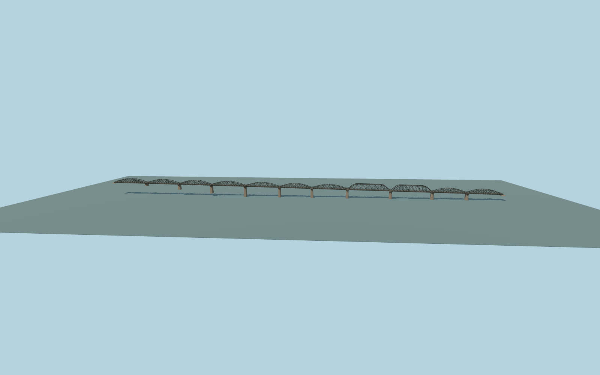

# River Kwai Bridge

Kanchanaburi railway bridge with open black curved trusses, two angular replacement spans, flared concrete piers, a single meter-gauge track, narrow walking plates and pier refuge bays.

Run `node packages/worldgen/scripts/generate-river-kwai-bridge.mjs` to rebuild the source master. Append `--check` to compare the exact bytes. Use `--ids=river_kwai_bridge` for targeted import, LOD generation and placement.

The track and map outline determine the frame. Pier stations, curved bay spacing, and member sizes are visual approximations based on ordinary photos.

The asymmetric grade adapts standard Terrarium terrain. The deck depicts the current rail crossing and fixed walkways.

Original geometry:repository license. Map:© OpenStreetMap contributors,ODbL-1.0;Protomaps. Standard terrain:terrain-grid.json. Ordinary pictures stay local and are not redistributed or used as textures. Current acceptance:qa.json.
