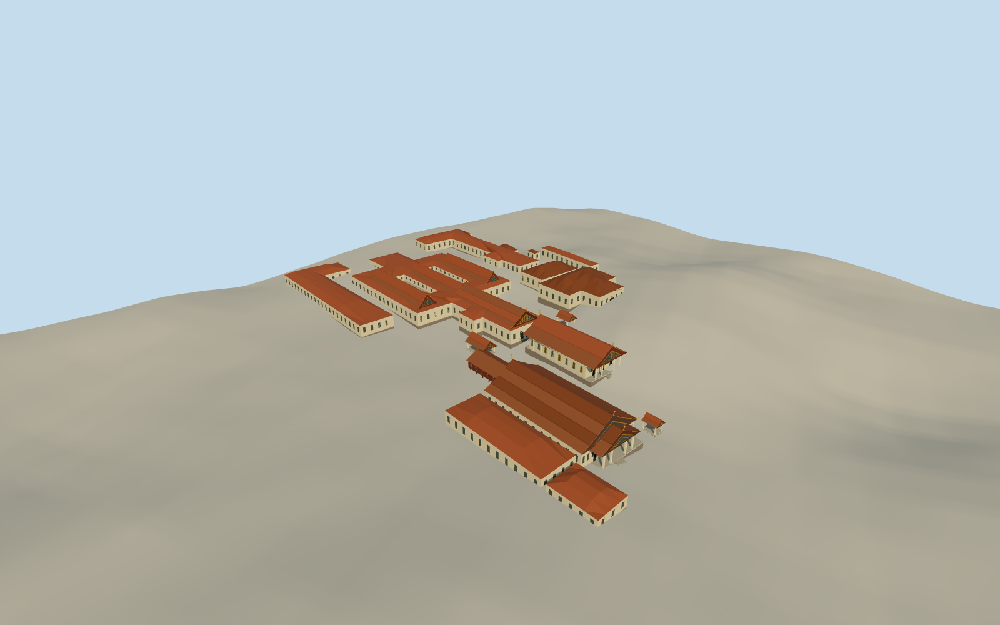

# Bangkok National Museum

Bangkok National Museum’s surviving Front Palace compounds, with stepped Thai roofs, the white Buddhaisawan Chapel, the raised Red House, the connected Phra Wiman residences and later exhibition halls.

Authoring state: **review-in-qa.json**. Current completion evidence is in [qa.json](qa.json) and the [completion ledger](../../../../qualla-structures/batches/qualla-003.PROGRESS.md).

- [Bangkok National Museum](https://qualla.com/bangkok-national-museum/)

The native map defines each building footprint and the two Phra Wiman courtyard openings. Roof pitch, wall section, distribution of doors and windows, and heights of associated museum buildings are architectural estimates.

Three exact 2017 reference images support the entrances and hall finishes. Written Thai architectural records supply the building types, ceremonial roof forms and relationships elsewhere in the compound.

Gilt reliefs, roof finials and fretwork are simplified. The depicted carvings, murals, Buddhist images and portable collections are outside the modeled scope.

The original elevation samples include effects from trees, roofs and the nearby river. Finished paving, stairs and exact historical foundation heights are approximate.

Build: `node content/worldgen/source/places/w4/w4r/bangkok_national_museum/models/generate-bangkok-national-museum.mjs`. Add `--check` to verify exact regeneration. 14448 triangles; 6 materials; no embedded photographs.
