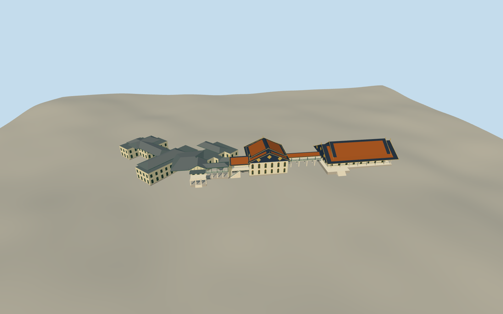

# Bhimarn Prathom Residence and Connected Royal Halls

Four connected royal halls with a blue-green tropical veranda at the east garden and stepped gold-edged Thai roofs to the north.

Authoring state: **review-in-qa.json**. Current completion evidence is in [qa.json](qa.json) and the [completion ledger](../../../../qualla-structures/batches/qualla-003.PROGRESS.md).

- [Sanam Chandra Palace](https://qualla.com/sanam-chandra-palace/)

The mapped compound perimeter, raised connecting gallery, court and audience hall perimeter are retained. Roof joins, threshold and storey heights, and the division of unmapped individual interiors are medium-fi estimates.

Only the east garden image of Bhimarn Prathom and corrected Vajariromaya original are used. The Aphirom Ruedi elevations and Samakkhi Mukhamat fenestration are inferred from government architectural descriptions and the shared layout.

Fine joinery, roof crest decorations and gable emblems are simplified. Closed windows and doors suggest the standing exterior; interior contents and art are outside the scope.

The original Terrarium terrain remains unchanged. The public grid helps register the connected plinths; doorstep, courtyard, stair and floor elevations are approximate.

Build: `node content/worldgen/source/places/w4/w4r/bhimarn_prathom_residence/models/generate-bhimarn-prathom.mjs`. Add `--check` to verify exact regeneration. 8304 triangles; 7 materials; no embedded photographs.
