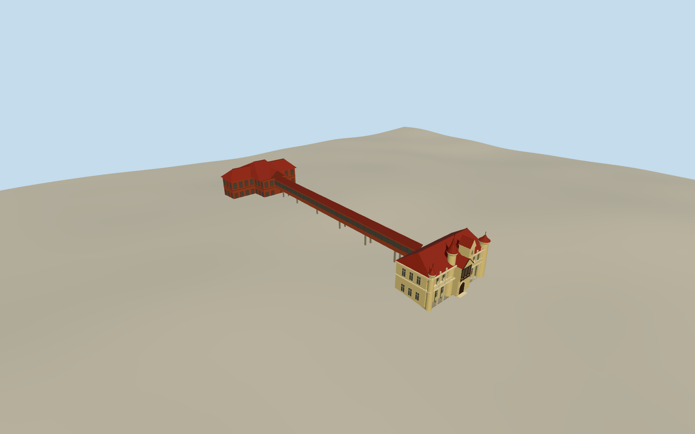

# Chaleemongkolasana and Maleeratanabanlang Residences

The turreted pale château and red timber royal residence, linked above the moat by a covered passage.

Authoring state: **review-in-qa.json**. Current completion evidence is in [qa.json](qa.json) and the [completion ledger](../../../../qualla-structures/batches/qualla-003.PROGRESS.md).

- [Sanam Chandra Palace](https://qualla.com/sanam-chandra-palace/)

North château modeling follows the exact Ananda public-domain original. Rear opening spacing, roof heights, turret cross sections and trim motifs are medium-fi estimates.

Maleeratanabanlang uses the named mapped perimeter and the published descriptions of two red teak storeys, rounded arches and timber corridor. Its facade rhythm, hip configuration, bridge glazing and supporting piers are estimated.

The 256 m public source terrain is unchanged. The grade around the moat and elevations of its banks are approximate. The main entrance and companion threshold are independently grounded, and a modest continuous bridge pitch keeps the covered upper-floor passage connected.

Covers the two connected residences and covered crossing. The dog monument, other halls, landscaping and the campus are separate site scopes.

Build: `node content/worldgen/source/places/w4/w4r/chaleemongkolasana_residence/models/generate-sanam-residences.mjs`. Add `--check` to verify exact regeneration. 4195 triangles; 5 materials; no embedded photographs.
