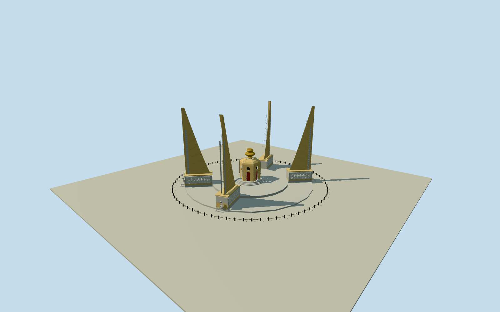

# Democracy Monument

Whole mapped Democracy Monument: four24m swept ochre wings/diagonal feather seams/pale edge trim, gray relief pedestals, Naga fountain spouts/basins, six-face central shrine with physical recessed red doors and round upper apertures, lobed roof/twin golden offering bowls/constitution book, native architectural platforms/steps and75 cannon posts/chains. Original bounded medium-fi sculpture; traffic island roads/gardens/temporary flags/people/interiors excluded.

Authoring state: **review-in-qa.json**. Current completion evidence is in [qa.json](qa.json) and the [completion ledger](../../../../qualla-structures/batches/qualla-002.PROGRESS.md).

- [Democracy Monument](https://qualla.com/democracy-monument/)

Exact native identity Q1186076/way178329973 and all four wing rectangles, central shrine outline, lower and upper plinth outlines preserved separately. Whole site boundary is identity context only, never an extruded building. Fixed native site bbox midpoint, +Xeast/+Zsouth, heading0; component bearings remain in original mapped frame.

All floor/section choices made only after immutable400m/129x129 independent field freeze. Floor0 at fixed8.0674m provider-relative SW datum; no terrain fit/flatten/reacquire. Native component outlines/bearings untouched. Four wings reach24m above lowerplatform. Native central7m part is approximate body metadata, not surveyed gold-book total; bounded six-face pavilion body/curved roof/twinbowls produce11.35m overall top, golden assembly3m. Door .34m and roundaperture .45m physical recesses. Pedestalheight/taper/thickness/roofstations/sculpture/hiddenfaces/cannon ring24m radius are original bounded estimates informed by exact PD photographs and official textual dimensions. Cannon75 count factual; precise azimuth/ground-contact/grade unresolved. No trafficisland fill.

Four exact July2006 creator-public-domain originals already published on Qualla only. No supplemental imagery/copied pixels/bitmaps/metadata repairs. Sculptural relief figures and Naga forms are original medium-fi approximations, no exact portraits/calligraphy or current finish survey. Native site boundary is context only and not filled; lower/upper plinth/component controls retained. Skyline omits small fence/fountains/relief figures; district restores75 posts/chains/round openings/physical doors; nearlevels restore original sculptural interpretations.

Independent400m129x129 sourcefield/two raw tiles frozen before all floors/sections. Fixed8.0674m provider datum unmodified. Urban DEM artifacts/source grade unsurveyed; exact footing and fountain basin contacts unresolved. Geographic preview/replaceFootprint=false; no fit/flatten/reacquire.

Build: `node content/worldgen/source/places/w4/w4r/democracy_monument/models/generate-democracy-monument.mjs`. Add `--check` to verify exact regeneration. 26112 triangles; 4 materials; no embedded photographs.
