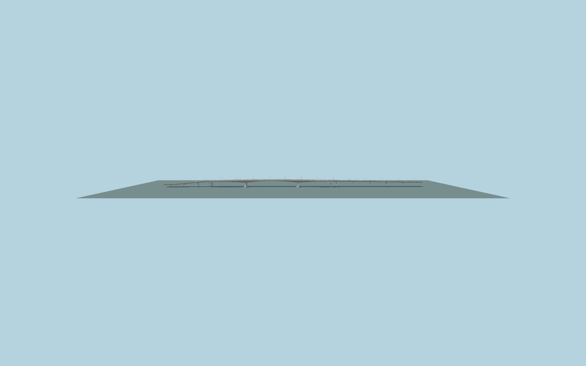

# Phra Pin-klao Bridge

Full Phra Pin-klao Bridge: three haunched concrete river spans, two large chamfered-foot river piers, both land approach viaducts, six-lane road/median/painted markings, main-river cantilever pedestrian walks, four mapped stair descents including western switchbacks, slim light-gray rails and paired curved streetlights. Preserve the independent lower Phra Athit crossing.

Rebuild: `node packages/worldgen/scripts/generate-phra-pin-klao-bridge.mjs`;append `--check` for exact source bytes. Select import/LOD/placement with `--ids=phra_pin_klao_bridge`. Detailed source and four browser tiers are separate ignored GLB outputs.

Fixed3m model datum. Approximate overall deck ranges8.4..18.4m above sea level, with elevated approaches and a shallow river crown. Standard review water samples 3.346m. Photo-led haunch/pier/stair sections and standard-terrain fit elevations are visualization controls, not surveyed engineering dimensions.

The seed279m polygon is only the river crossing; this original medium-fi exterior follows the full617m current mapped bridge. Girder/pier/footing sections, stair grades and land supports, road lane allocation and light count are ordinary-photo approximations. Approach deck width is narrower than the river walks so flights descend outside the vehicle girders. No copied photos/meshes, furnished interiors, readable labels, vehicles or baked night lighting. Independent ferry structures, buildings, canals and lower roads remain native. Coarse urban terrain can affect local stair grades and bank connections. Physical laptop/phone timing measurements remain pending.

Original geometry:repository license. Map:© OpenStreetMap contributors,ODbL-1.0;Protomaps. Standard terrain:terrain-grid.json. Ordinary pictures stay local and are not redistributed or used as textures. Current acceptance:qa.json.
