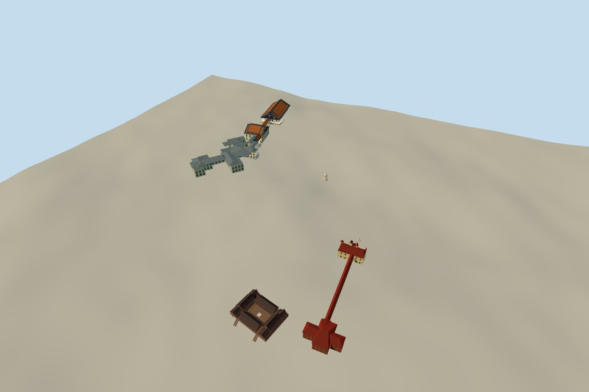

# Sanam Chandra Palace

Five independent exterior models cover the story's royal precinct in Nakhon Pathom. They include the Chaleemongkolasana and Maleeratanabanlang residences and their connecting bridge, the Bhimarn Prathom residence and attached royal halls, Thap Khwan Residence, the Ganesha shrine and the Yah Leh monument. The same five assets appear in their individual geographic placements and in the story catalog.

The site review uses an unchanged 512 m Terrarium field, the existing placement coordinates and headings, and the independently sampled ground datum of each asset. Vertical contact remains approximate at this DEM resolution. The modeled site covers the structures identified for the story. The historical estate extends through surrounding gardens, campus and buildings outside that scope. Each member source records its own imagery basis and estimated details.

[Sanam Chandra Palace story](https://qualla.com/sanam-chandra-palace/)

Regenerate the assembly with `node content/worldgen/source/places/w4/w4r/sanam_chandra_palace/generate-collection-scene.mjs`. Use `--check` to verify the current assembly.
