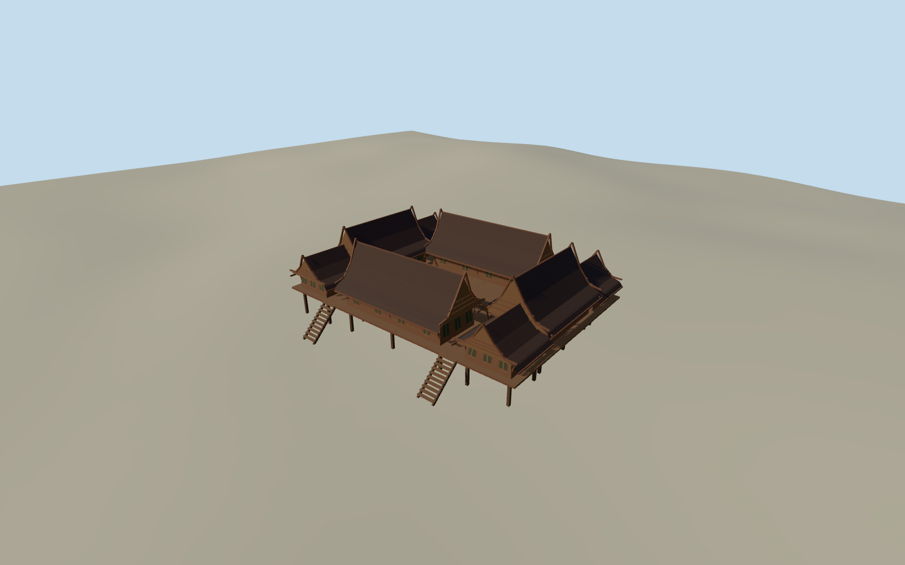

# Thap Khwan Residence

Eight dark teak pavilions with steep curved clay tile roofs surround a raised deck open to the sky.

Authoring state: **review-in-qa.json**. Current completion evidence is in [qa.json](qa.json) and the [completion ledger](../../../../qualla-structures/batches/qualla-003.PROGRESS.md).

- [Sanam Chandra Palace](https://qualla.com/sanam-chandra-palace/)

The native outline governs the overall scale and heading. The eight house envelopes, roof heights and exact spacing within it are architectural estimates.

The garden side uses the exact Qualla public-domain photograph. Hidden joinery, door placement and service-house elevations are estimated. The dark ceramic roof replaces the original thatch in the standing restored phase.

Ground comes from the unchanged public terrain grid. Timber column thresholds, individual steps and the central tree well are approximate. Ground surfacing below the timber deck is furnished by the viewer.

Build: `node content/worldgen/source/places/w4/w4r/thap_khwan_residence/models/generate-thap-khwan.mjs`. Add `--check` to verify exact regeneration. 6040 triangles; 4 materials; no embedded photographs.
