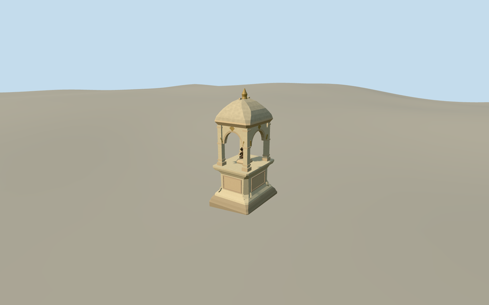

# Thewalai Khanet, Ganesha Shrine

The tall four-sided shrine and domed canopy that houses the palace’s west-facing bronze Ganesha.

Authoring state: **review-in-qa.json**. Current completion evidence is in [qa.json](qa.json) and the [completion ledger](../../../../qualla-structures/batches/qualla-003.PROGRESS.md).

- [Sanam Chandra Palace](https://qualla.com/sanam-chandra-palace/)

The mapped shrine perimeter and west facing axis are retained. Section heights, local footing, access dimensions and canopy curvature are estimated.

Canopy profile, platform ornament and the character of the open portals follow architectural descriptions. Exact sculptural motifs, relief, finish colors and hidden surfaces are inferred.

The small bronze figure is a simplified original rendering from textual identification, materials and facing. Its individual iconographic details are approximate.

The original terrain is used at the mapped lawn and no ground shaping is authored.

Build: `node content/worldgen/source/places/w4/w4r/thewalai_khanet/models/generate-thewalai-khanet.mjs`. Add `--check` to verify exact regeneration. 2808 triangles; 5 materials; no embedded photographs.
