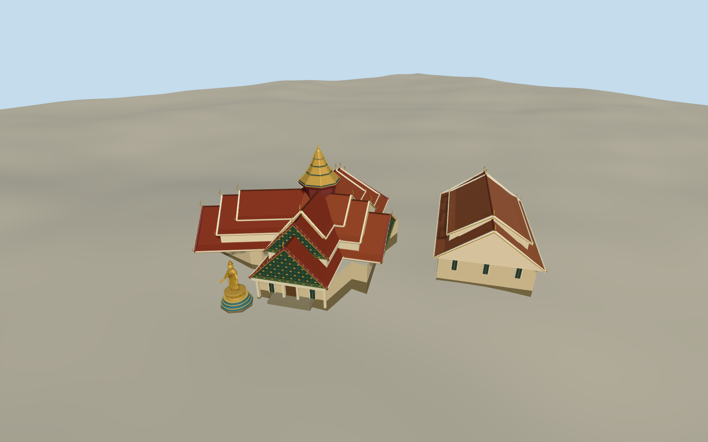

# Wat Bang Phra

Wat Bang Phra in Nakhon Pathom with its tiered red roofs, gilded tower, ornamented gables and standing golden figure.

Authoring state: **review-in-qa.json**. Current completion evidence is in [qa.json](qa.json) and the [completion ledger](../../../../qualla-structures/batches/qualla-003.PROGRESS.md).

- [Wat Bang Phra](https://qualla.com/wat-bang-phra/)

The exact named temple area is mapped. The assignment of the photographed hall and neighbor to their roof outlines, roof rises, placement of the standing figure, and intricate gilded relief are photo-guided estimates.

The model represents the temple exterior shown in the reference and its adjoining roof. Remaining compound buildings and interiors are outside the authored scope.

Build: `node content/worldgen/source/places/w4/w4r/wat_bang_phra/models/generate-wat-bang-phra.mjs`. Add `--check` to verify exact regeneration. 13812 triangles; 6 materials; no embedded photographs.
