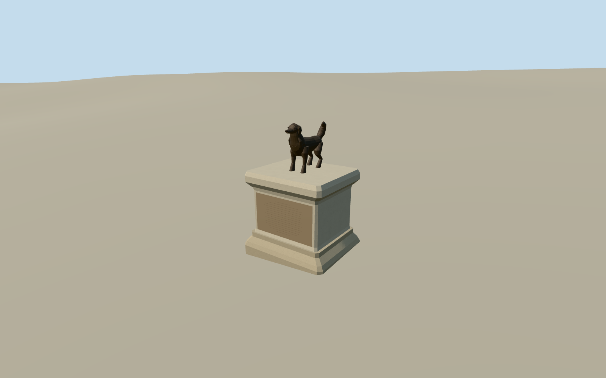

# Yah Leh Monument

The life-size bronze cast of Yah Leh and its inscribed garden pedestal at Sanam Chandra Palace.

Authoring state: **review-in-qa.json**. Current completion evidence is in [qa.json](qa.json) and the [completion ledger](../../../../qualla-structures/batches/qualla-003.PROGRESS.md).

- [Sanam Chandra Palace](https://qualla.com/sanam-chandra-palace/)

The exact named monument point fixes the position. The pedestal dimensions beyond the measured sign and its garden-facing orientation are estimates.

The figure is an original model of a life-size long-coated dog based on the stated standing pose, drooping ears, neck ruff and bushy tail. Fine likeness and proportions are approximate.

The 112 by 66 cm plaque is modeled at the documented size. The sixteen lines use abstract relief strokes.

The terrain grid is reproduced unchanged and footing depth is approximate.

Build: `node content/worldgen/source/places/w4/w4r/yah_leh_monument/models/generate-yah-leh-monument.mjs`. Add `--check` to verify exact regeneration. 3032 triangles; 3 materials; no embedded photographs.
