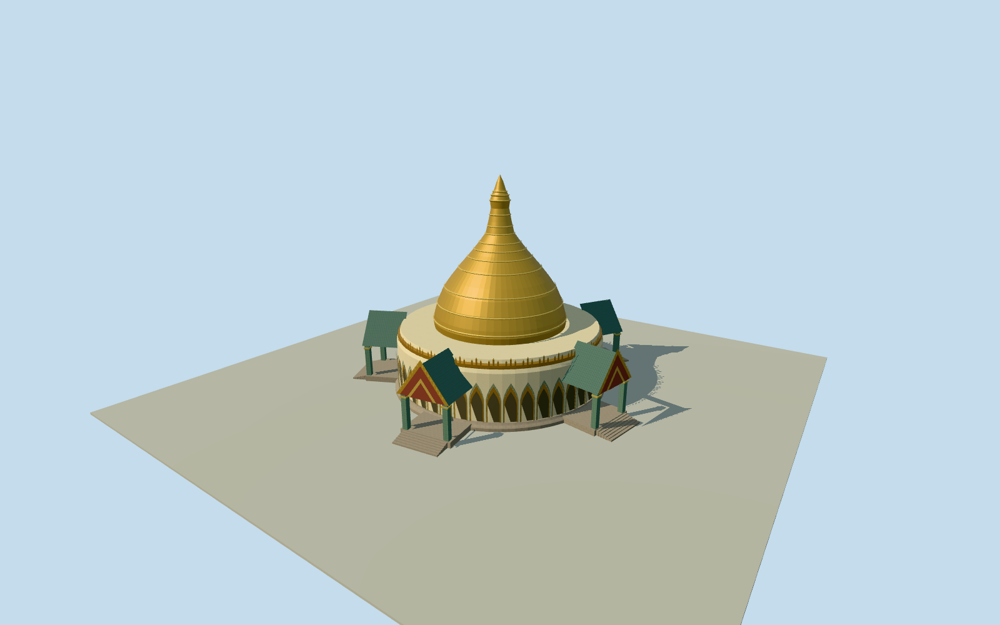

# Kaba Aye Pagoda

Kaba Aye’s gilded bell and spire rise over a circular prayer hall and five red-and-gold gabled porches.

Authoring state: **review-in-qa.json**. Current completion evidence is in [qa.json](qa.json) and the [completion ledger](../../../../qualla-structures/batches/qualla-003.PROGRESS.md).

- [Kaba Aye Pagoda](https://qualla.com/kaba-aye-pagoda/)

The model represents the March 2015 exterior of the central Kaba Aye Pagoda. The surrounding grounds and separately named cave are outside scope.

The photograph fixes the cladding, bell curve, trim and one porch. Other porches, exact gateway axes, relief details and ground registration are approximate.

Build: `node content/worldgen/source/places/w4/w4u/kaba_aye_pagoda/models/generate-kaba-aye-pagoda.mjs`. Add `--check` to verify exact regeneration. 9408 triangles; 5 materials; no embedded photographs.
