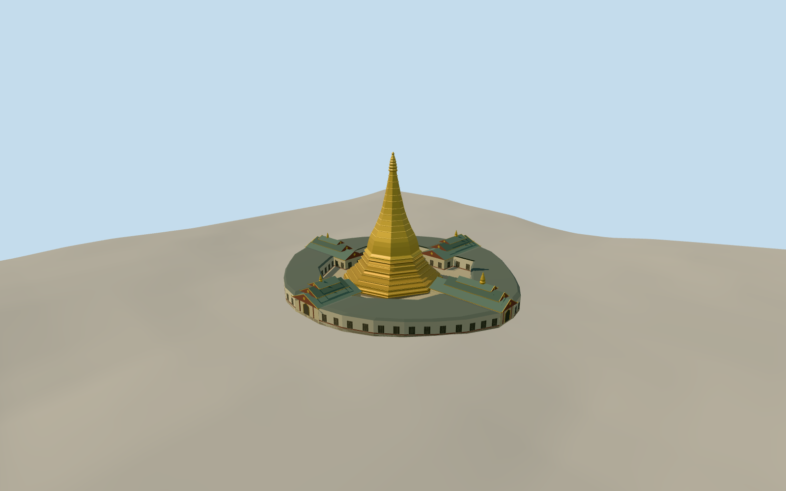

# Sule Pagoda

The gilt octagonal Sule stupa, 151 feet high, with the four cardinal worship halls and mapped perimeter ranges in central Yangon.

Authoring state: **review-in-qa.json**. Current completion evidence is in [qa.json](qa.json) and the [local 100 ledger](../../../../qualla-structures/batches/PROGRESS.md).

- [Sule Pagoda](https://qualla.com/sule-pagoda/)

The model represents the standing precinct following its 2023 regilding. Historic photographs establish the central stupa proportions while the present outer buildings follow their mapped plans.

The tier proportions, doorway height, roof ornament, finial details and modern storefront divisions are estimates.

The immediate court is included. Streets, overhead crossings, neighboring buildings, freestanding interior shrines and signs are outside the model scope.

Build: `node content/worldgen/source/places/w4/w4u/sule_pagoda/models/generate-sule-pagoda.mjs`. Add `--check` to verify exact regeneration. 10840 triangles; 6 materials; no embedded photographs.
