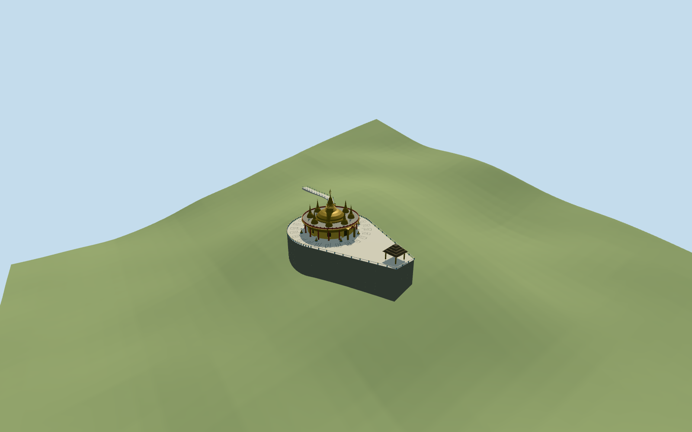

# Buddha Dhatu Jadi

Buddha Dhatu Jadi standing hilltop shrine: round yellow/gilded enclosed hall with maroon/gold columned outer arcade, true recessed closed portal, lobed original arcade heads/entry crest, round gray roof/maroon-gold parapet. Broad central bell/ringed conical neck/crown/open umbrella finial and eight smaller surrounding stupas. Pictured teardrop paved terrace/blue-pale boundary posts, dark gold-edged pointed-end tiered canopy, simplified original seated figures/lotus seats/small umbrellas. Upper approach/gold gateway and mapped stair descent to the retained third stair control. Exact rooms, fine copied sculpture/inscriptions, forest/solar fixtures/visitor objects and remaining lower path are not authored.

## Evidence and reconstruction

Published dimensions and reconstructed details are separated in spec.json. Primary references:

- [Reference](https://commons.wikimedia.org/wiki/File:Buddha_Dhatu_Jadi_DJI_0249-1.jpg)
- [Reference](https://commons.wikimedia.org/wiki/File:Buddha_Dhatu_Jadi_-_Bandarban_Golden_Temple.jpg)

Buddha Dhatu Jadi standing hilltop shrine: round yellow/gilded enclosed hall with maroon/gold columned outer arcade, true recessed closed portal, lobed original arcade heads/entry crest, round gray roof/maroon-gold parapet. Broad central bell/ringed conical neck/crown/open umbrella finial and eight smaller surrounding stupas. Pictured teardrop paved terrace/blue-pale boundary posts, dark gold-edged pointed-end tiered canopy, simplified original seated figures/lotus seats/small umbrellas. Upper approach/gold gateway and mapped stair descent to the retained third stair control. Exact rooms, fine copied sculpture/inscriptions, forest/solar fixtures/visitor objects and remaining lower path are not authored.

## Model and axes

27,995 triangles; 83,985 vertices; 5 material groups; 3,362,848 bytes. Native bounds: -27.020, -6.533, -41.464 to 18.967, 26.050, 70.691. Source hash: `sha256:19b99c40e5909c21544bb9559995b67dfa1ebbfaec90dd5de4f9029d5aa6b842`.

{"x":"east","y":"up","z":"south"}

The geographic proposal uses exact-QID OpenStreetMap evidence. Map-derived orientation and estimated architectural details require real-site visual review; preview eligibility is distinct from geographic/fidelity approval. Map attribution: © OpenStreetMap contributors, ODbL-1.0.

## Reproduce

Run `node packages/worldgen/scripts/generate-additional-landmarks.mjs --ids=buddha_dhatu_jadi` (or add `--check`). The generator preserves manually edited masters by checking their baseline hashes. Import through the standard authored-model workflow with optimization disabled; then capture all QA cameras, including shared-surface views.

## Pending work

- Buddha Dhatu Jadi standing hilltop shrine: round yellow/gilded enclosed hall with maroon/gold columned outer arcade, true recessed closed portal, lobed original arcade heads/entry crest, round gray roof/maroon-gold parapet. Broad central bell/ringed conical neck/crown/open umbrella finial and eight smaller surrounding stupas. Pictured teardrop paved terrace/blue-pale boundary posts, dark gold-edged pointed-end tiered canopy, simplified original seated figures/lotus seats/small umbrellas. Upper approach/gold gateway and mapped stair descent to the retained third stair control. Exact rooms, fine copied sculpture/inscriptions, forest/solar fixtures/visitor objects and remaining lower path are not authored.
- Named standard PMTiles templePOI17593731024186 (encoded OSMnode1544979770) is within0.07m of retainedQ4984151 reference92.1977168,22.2231095. There are no building polygons here. Stairway35184513225530 starts[-10.285015840203268,15.736215813772516]m from that anchor and bends through[-19.68271432603095,31.214801302840527] to[-25.487175155512755,70.46414044439314]. Its first distance fixes about18.7992031472309m rounded terrace radius. The aerial upper-stair allocation at local-2.436rad fixes approximate signed terrace axis-1.7138035310009077rad: pointed canopy toward north-northwest, mapped approach toward south-southwest. Main circle/teardrop proportions, portal/canopy/figure placement and hidden inventory remain photo/map estimates with about10m/30degree uncertainty; the near-vertical aerial is not treated as an unrotated map. No generic building shell is replaced.
- Retained catalog height18.288m has no measured-point qualifier, and is used as nominal main-terrace-to-finial18.3m, not a survey. Picture-led estimates: circular shrine radius12m/roof5.5m, enclosed radius10m/outer supports about4.8m, central bell base radius6.4m from5.8m and umbrella crown to18.3m. Eight smaller stupas on8.7m ring rise about6.2m above the roof. Round terrace radius18.7992031472309m, pointed-end canopy near localX36m; outer canopy tiers about6m high. Main/fine finial profiles, support count, ornament, boundary/figure inventory and current finish remain simplified dated-picture estimates.
- Keep original standard6m Mapzen hill grid, native paths/water and zero building-polygon set unchanged. Model terrace uses a level occupied floor above sampled terrace/upper landing maxima, individually buried retaining sides and grade-fitted stair treads along the mapped upper descent. No ground/water cutout or terrain flattening. Coarse DEM reverses part of the pictured upper stair slope and does not resolve the summit; short upper approach/long lower treads and deep exposed retaining faces are visualization contact estimates, not surveyed hill, retaining-wall or accessible-route engineering. Only the first three mapped stair controls are authored; the remaining route stays independent.
- Two useful2017/2020 whole front/aerial pictures and standard PMTiles control approximate appearance and placement. No building polygons; named node/stair support10m/30degree estimated envelope/facing. Coarse hill grid does not resolve terrace/stair/foundation levels. No copied sculpture/inscription atlas, hidden furnished interior, forest or temporary equipment.

This bundle follows the medium-fi standard. Medium-fi appearance and geographic fit are reviewed separately. Hash-bound visual acceptance is recorded separately after capture inspection.

## Additional geographic data

©OpenStreetMap contributors; Protomaps; Mapzen/USGS terrain.
