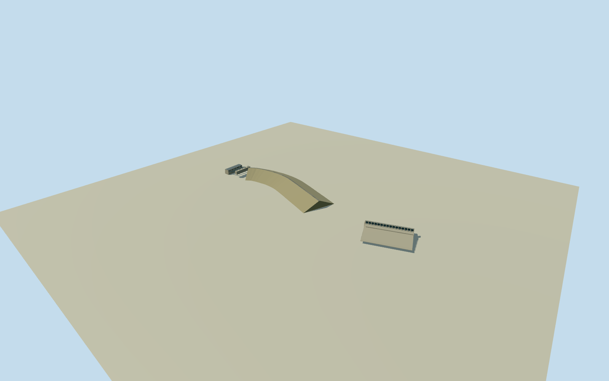

# Kaptai Dam — Karnaphuli

WholeKaptai earth-fill dam and intrinsic leftbank16radialgate227mspillway, fullwesternfive-unit230MWpowerhouse/intake/penstockexteriors. OriginalQ1734089named22controlphysicaldam/16crest-road controls and independent7controlspillwayenvelope. PrimaryADB/CUET/JICAengineeringdimensions and primaryfieldresearch western-turbine location. Entiredamheight45.7m/crest7.6m and native666.66mcrest route retained; exactsection/toes/plantplan/roof/gateheight/chutes/finish/grade estimated. No bareembankment/singlegate/oneunitproxy, no solarplant/reservoir/neighbor substitution, allimageryunused.

Authoring state: **review-in-qa.json**. Current completion evidence is in [qa.json](qa.json) and the [completion ledger](../../../../qualla-structures/batches/qualla-002.PROGRESS.md).

- [Kaptai Dam](https://qualla.com/kaptai-dam/)

WholeKaptai earth-fill dam and intrinsic leftbank16radialgate227mspillway, fullwesternfive-unit230MWpowerhouse/intake/penstockexteriors. OriginalQ1734089named22controlphysicaldam/16crest-road controls and independent7controlspillwayenvelope. PrimaryADB/CUET/JICAengineeringdimensions and primaryfieldresearch western-turbine location. Entiredamheight45.7m/crest7.6m and native666.66mcrest route retained; exactsection/toes/plantplan/roof/gateheight/chutes/finish/grade estimated. No bareembankment/singlegate/oneunitproxy, no solarplant/reservoir/neighbor substitution, allimageryunused.

PrimaryADB2018installation overview originalPDFpage2 confirms rounded671m/46m earthfilldam, complete227m16gatespillway and five2x40MW+3x50MW units commissioned1962-1988. CUET2015actualcachedPDFTable1supplies670.6m/45.7m/7.6mcrestwidth; originalPDF404explicit. JICA2016cachedconstructionparagraph supplies16radialgates11.5mwideonleftbank; originalPDFtimeout/oversizeexplicit. 2021primaryfieldresearch section3.1says turbineswestofmaindam; conflictingfourunitcensusnotadopted. All protected figures/photos/maps and proposed solar/hydrokinetic additions unused.

Original22controldamarea,16connectedoriginalroadcontrols and7quantizedspillwayenvelopecontrols retained. Mappedroadsegment length666.663m is preserved rather than stretched to reported670.6m; endpoints define originalmaincrest approximation. Nativewaterwaydamarea is not surveyed toe boundary; sideprofile2.1H:1V/toe extent estimated aroundoriginalcrownroute. All dam/road/spillway roles and historical2018registration approximate.

After originalframe and independent2048mfield, floors/mainsections fixed: localcrest6.6m, nominaldamheight45.7m/base-39.1m, crown7.6m, crownroad6m. Relativecrest6.6 is an explicit estimate against30.8359mprovideranchor, not a surveyed37.4359mcrest/MSL. WaterMSLlevels are not used as structural heights or provider-datum controls. All floors/sections remain fixed throughreview.

Complete spillway original7control envelope retained, gateaxis interpreted aslinebetweenoriginalendmidpoints, lengthabout222.413m rather than stretched to227m. All16radialgatepanels11.5mclearwidth retained atfourLODs. Gateheight11.3m, concretepier/thickness/bridge/hoist positions and110mdownstreamchute/drop/foundations/wingwalls explicitly estimated with10mcomponent/3mheightuncertainty. Closedstaticgatepose, no hydrological operation claim.

Wholewesternfiveunitpowerhouse118x34m estimated plan center[-365,100]m, longitudinalnorthsouthaxis, floor-23.4m/walltop-7.4m/gableroofridge-5.4m. Allfiveunitbays/walls/fullroof and associated intake115x18m/fiveexternalpenstocks/tailrace outlets retained. Exact historicplan/roofprofile/fenestration/structuralpiers/penstocksections/finish estimated, nominal25percentplan/50mregistration/5mheight uncertainty. Primary supportswestlocation/fiveunits, not these measuredarchitecturaldimensions. No anonymousunrelatedbuilding used as plantfootprint.

Original independent2048m/16641heights/ninerawtiles field preserved, with severe providerDEM lowartifact-389.6323m against30.8359manchor and localurban/water/canopy artifacts. Originalfield is not bathymetry or foundation/2018ground survey. Lowerdam/powerhouse/spillway works may be buried/float against sourcefield. Verticalregistration/groundcontact unverified. No cutout/mask/flatten/refetch/refit or floor/sectionmovement for views.

Historical2018constructionconfiguration only, valid2018-06-01to2019-06-01. Wholephysicaldam/spillway/intake/powerhouseexteriors included, detachedsolarplant/substation/transmissionline/neighborbuildings and surroundingriver/reservoirexcluded as distinctobjects; interiors/operatingturbines not represented. Allimageryunused, Quallasearchedfirst, no questionableLIFE/modernCCBYsource adopted or sourcequestions. No currentworldreplacement/photographic/survey claim.

Build: `node content/worldgen/source/places/w5/w5c/kaptai_dam/models/generate-house.mjs`. Add `--check` to verify exact regeneration. 8938 triangles; 6 materials; no embedded photographs.
