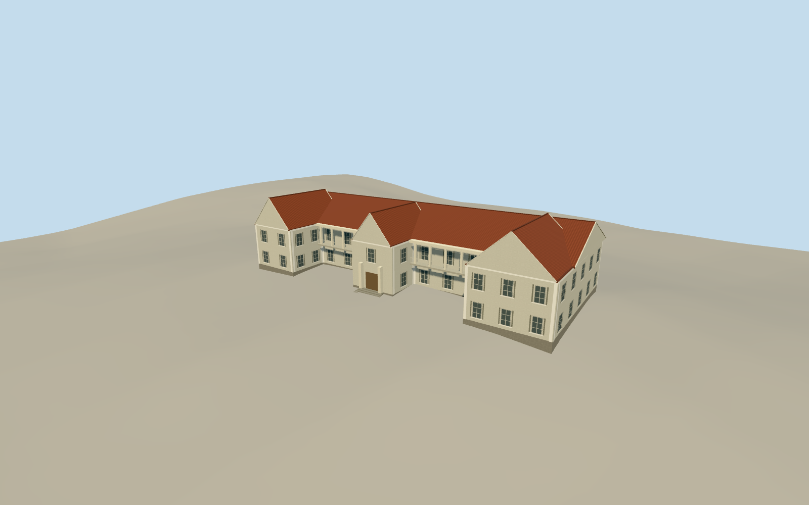

# Zia Memorial Museum, Chittagong

Chittagong’s Old Circuit House, a white two-storey brick residence with a red tiled roof, three projecting pavilions and an upper verandah.

Authoring state: **review-in-qa.json**. Current completion evidence is in [qa.json](qa.json) and the [completion ledger](../../../../qualla-structures/batches/qualla-003.PROGRESS.md).

- [Zia Memorial Museum](https://qualla.com/zia-memorial-museum/)

The model represents the standing historic Circuit House, using its exact mapped perimeter, two-storey brick envelope, white plaster, red roof tiles, tall windows and documented upper verandah.

The three mapped facade projections constrain the principal masses. Gable profiles, sash arrangement, veranda bays, later exterior fittings, ornamental work and building levels remain estimates.

The original site height field is preserved. Entrance steps and foundation heights use an approximate local grade.

Build: `node content/worldgen/source/places/w5/w5c/zia_memorial_museum/models/generate-zia-memorial-museum.mjs`. Add `--check` to verify exact regeneration. 2657 triangles; 5 materials; no embedded photographs.
