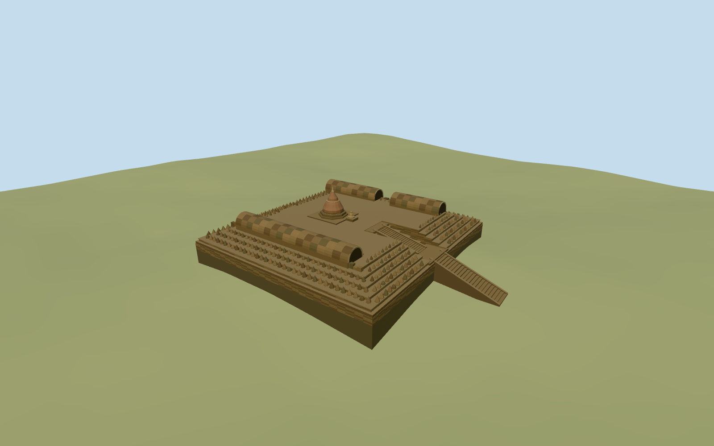

# Koe-thaung Temple

The terraced Koe-thaung temple ruin at Mrauk U, with its outer ranks of stone stupas, surviving vaults, east approach and upper shrine.

Authoring state: **review-in-qa.json**. Current completion evidence is in [qa.json](qa.json) and the [completion ledger](../../../../qualla-structures/batches/qualla-003.PROGRESS.md).

- [Koe-thaung Temple](https://qualla.com/koe-thaung-temple/)

This shows the exterior as a standing and restored ruin. It does not restore a continuous ancient superstructure or claim every stupa position survived.

Tier widths, vault openings, surviving stupa counts and roof heights are inferred from two current side photographs and the survey text. Individual reliefs, interior figures and contemporary railings are outside scope.

Original Terrarium sampling gives the site grade; exact thresholds and historic course elevations are approximate.

Build: `node content/worldgen/source/places/w5/w5d/koe_thaung_temple/models/generate-koe-thaung-temple.mjs`. Add `--check` to verify exact regeneration. 25162 triangles; 5 materials; no embedded photographs.
