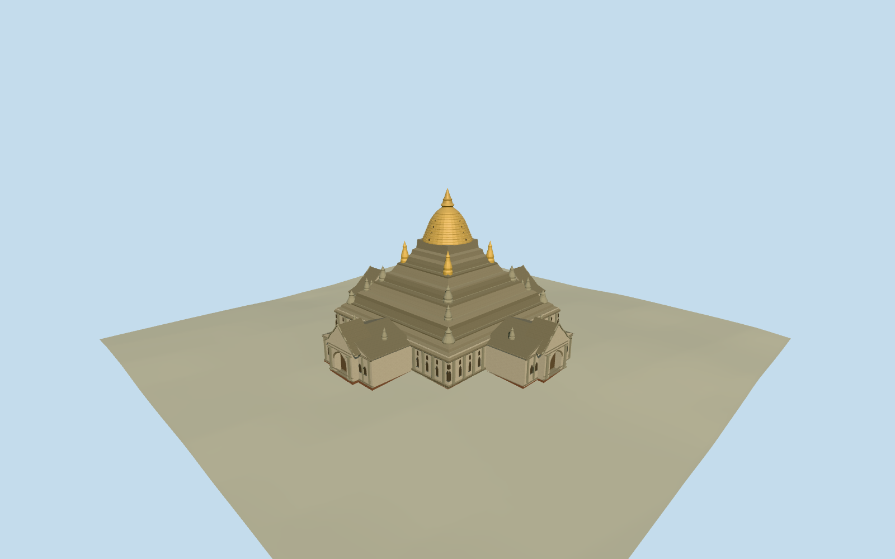

# Ananda Temple

Bagan’s Ananda Temple, with four gabled porticoes, stepped stupas and the gilded central shikhara.

Authoring state: **review-in-qa.json**. Current completion evidence is in [qa.json](qa.json) and the [completion ledger](../../../../qualla-structures/batches/qualla-004.PROGRESS.md).

- [Ananda Temple](https://qualla.com/ananda-temple/)

Exact stucco carving, relief plaques, window tracery and some individual tower profiles are approximate.

Model scope covers the temple’s exterior and four connected entry halls. Interior shrines and detached enclosure structures remain outside the structure model.

Build: `node content/worldgen/source/places/w5/w5g/ananda_temple/models/generate-ananda-temple.mjs`. Add `--check` to verify exact regeneration. 17146 triangles; 7 materials; no embedded photographs.
