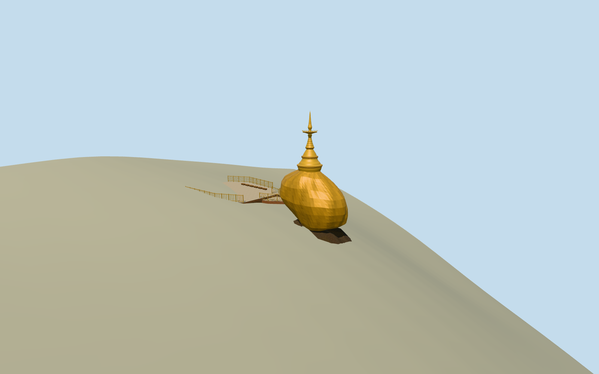

# Kyaiktiyo Pagoda

Myanmar’s Golden Rock at Kyaiktiyo, with its crown stupa, cliff ledge and guarded approach.

Authoring state: **review-in-qa.json**. Current completion evidence is in [qa.json](qa.json) and the [completion ledger](../../../../qualla-structures/batches/qualla-004.PROGRESS.md).

- [Kyaiktiyo Pagoda](https://qualla.com/kyaiktiyo-pagoda/)

The boulder crown, underside and support ledge use coarse native relief and visible profiles in the verified photographs. The horizontal extents and small railing elements are estimates.

The model covers the immediate shrine, deck and access only. Adjacent pavilions and the wider grounds are outside the mapped structure extent.

Build: `node content/worldgen/source/places/w5/w5j/kyaiktiyo_pagoda/models/generate-kyaiktiyo-pagoda.mjs`. Add `--check` to verify exact regeneration. 16256 triangles; 6 materials; no embedded photographs.
