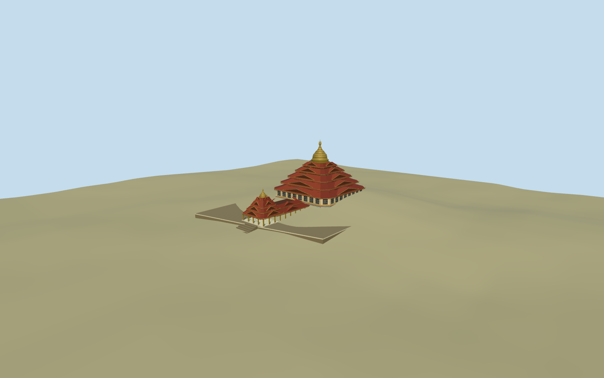

# Phaung Daw U Pagoda

Phaung Daw U Pagoda in Inle Lake, with red tiered roofs, gilded stupa and the covered waterfront arrival hall.

Authoring state: **review-in-qa.json**. Current completion evidence is in [qa.json](qa.json) and the [completion ledger](../../../../qualla-structures/batches/qualla-003.PROGRESS.md).

- [Phaung Daw U Pagoda](https://qualla.com/phaung-daw-u-pagoda/)

Horizontal dimensions follow the standing named building, its attached arriving hall and the mapped pedestrian court. Roof-tier heights, decorative carving and exact landing-pavilion cross-sections are approximated from the photographs.

The independent local radar-derived raster contains roof returns over the shrine. A local cutout is bounded by the mapped pedestrian terrace. Canal water level, retaining wall and stairs are estimated from the visible waterfront and native local terrain. The raw terrain and unmasked field are retained.

The surrounding market, ceremonial boats and boathouse, temporary flags and the shrine’s interior statues are outside scope.

Build: `node content/worldgen/source/places/w5/w5s/phaung_daw_u_pagoda/models/generate-phaung-daw-u-pagoda.mjs`. Add `--check` to verify exact regeneration. 12963 triangles; 6 materials; no embedded photographs.
