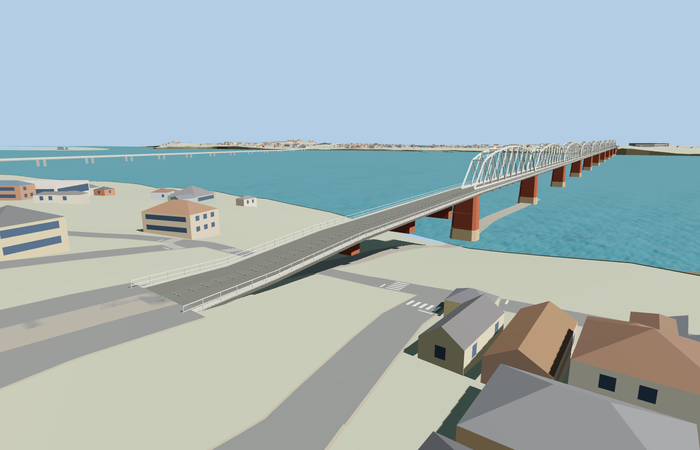

# Ava Bridge

Dated intact Ava rail/road bridge: nine principal pale polygonal through-trusses, open vertical/diagonal webs, paired top crossframes, flanged steel members and gussets, central rails and sleepers, outside narrow roads/walks, red masonry pier shafts and pale chamfered footings. Original bridge only; the separate Yadanabon crossing remains map context.

Editable geometry lives in models/; model-brief.json records the material library, four authored runtime levels, reference pictures and reconstruction limits. The detailed master is reproducible from this editable recipe; inspection and readiness decisions are recorded separately. All GLBs are ignored generated outputs.

Regenerate with `node content/worldgen/source/places/w5/w5u/ava_bridge/models/generate-ava.mjs --ids=ava_bridge`. Append `--check` to verify exact reconstruction. Import with `node packages/worldgen/scripts/import-structure-models.mjs --ids=ava_bridge`, then generate runtime levels with `node packages/tooling/scripts/generate-landmark-lods.mjs --ids=ava_bridge`.

## Review status

Current completion decisions are in qa.json and QA-REVIEW.md when present; the readiness catalog is authoritative. integration-review.json records the source scope; qa.json records current inspection. placement-draft.json preserves the proposed orientation, datum and bounded replacement rules. A source build alone grants no visual or geographic approval.

Original geometry uses the repository license. Map-derived controls: © OpenStreetMap contributors, ODbL-1.0. Reference photos retain their own rights and are not model textures.
