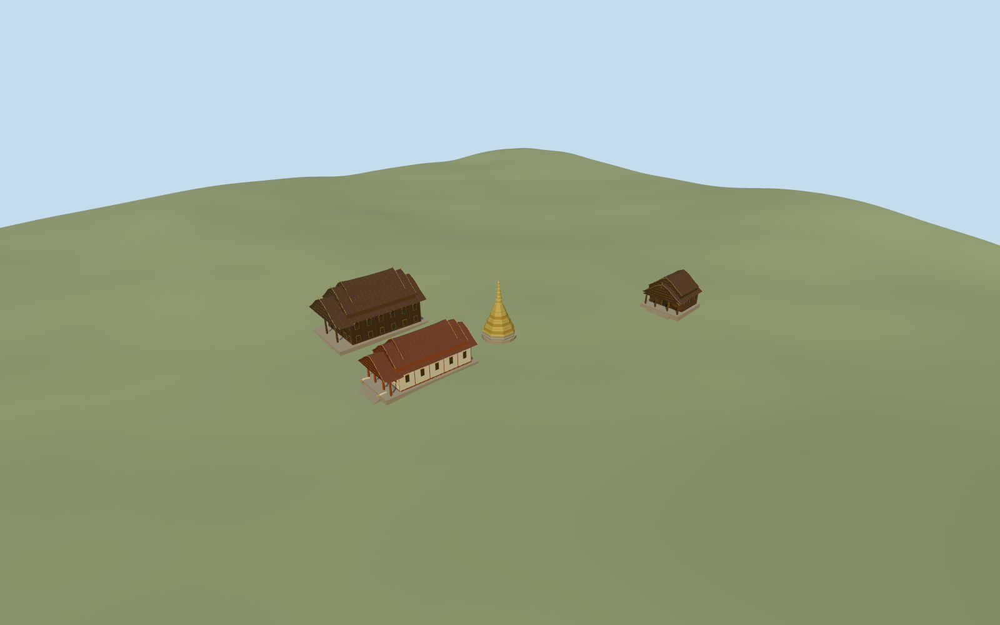

# Wat Phra Kaew, Chiang Rai

Wat Phra Kaew in Chiang Rai, including the Chiang Saen ordination hall, nine-tier golden chedi, Phra Yok Hall and teak museum.

Authoring state: **review-in-qa.json**. Current completion evidence is in [qa.json](qa.json) and the [completion ledger](../../../../qualla-structures/batches/qualla-003.PROGRESS.md).

- [Wat Phra Kaew, Chiang Rai](https://qualla.com/wat-phra-kaew-chiang-rai/)

Current temple exteriors are represented. The present ordination hall was remodeled in 1960 and its gable finial was mounted in 2007. This is not the 1940s temple form.

The native stupa outline and four named or contextually identified footprints are fixed. Minor span, floor heights, tile shades, Jade Hall trim and individual sculpture are simplified or approximate.

Original local relief is retained. Grounds, minor buildings and museum and worship interiors are outside the authored scope.

Build: `node content/worldgen/source/places/w5/w5w/wat_phra_kaew_chiang_rai/models/generate-wat-phra-kaew-chiang-rai.mjs`. Add `--check` to verify exact regeneration. 18173 triangles; 6 materials; no embedded photographs.
