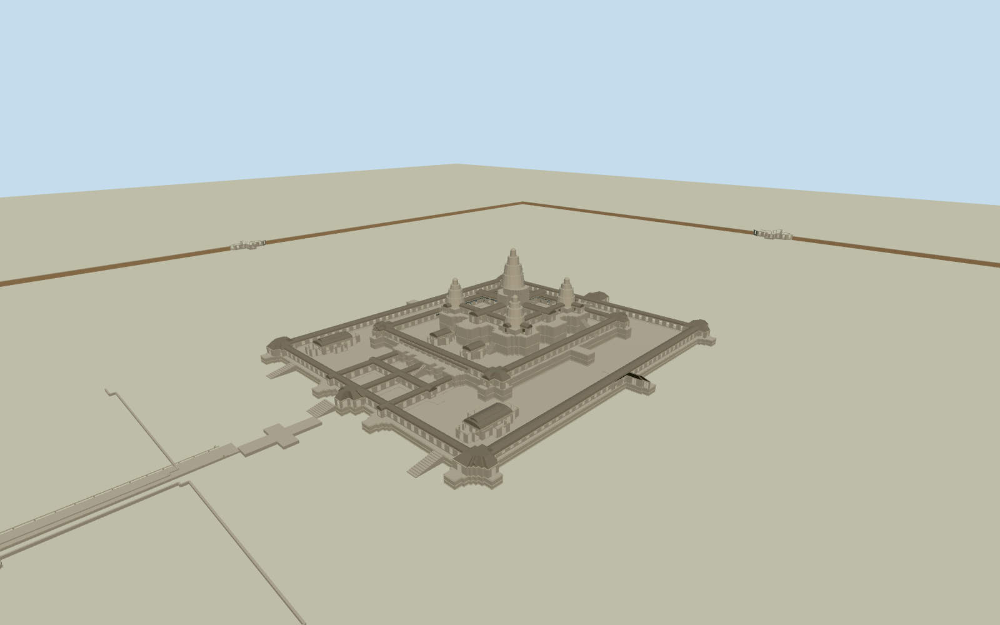

# Angkor Wat

Complete ancient Angkor Wat architectural ensemble: native three concentric galleries/open courts, five articulated lotus-bud towers, curved corbelled stone roofs, real gallery openings/colonnade and turned balusters, layered plinths/steep steps, six libraries and cruciform galleries, full outer laterite enclosure/four gateways, monumental west gopura and ancient causeway/naga rails. Exact native master plans with photographically estimated sections/repeats and simplified far levels; no natural moat/forest/site slab or later separate monastery/stupa.

Authoring state: **review-in-qa.json**. Current completion evidence is in [qa.json](qa.json) and the [completion ledger](../../../../qualla-structures/batches/qualla-002.PROGRESS.md).

- [Angkor Wat](https://qualla.com/angkor-wat/)

Exact original OSM area payload establishes three gallery multipolygons/courtyard holes, fifty explicit-height roof/tower parts and five tower footprint controls, six library footprints, cruciform galleries/Terrace of Honor, four outer gateways, four enclosure wall polylines and the ancient west causeway polygon. Original coordinates retained in source/map controls; native heights and note="simplified shape" are mapped estimates, not survey accuracy. Roof sections, stone steps/courses/colonnade and baluster/window repeats, lost gate fragments and concealed details are photographic medium-fi interpretations. Far LODs simplify small plan articulations while retaining all defining structures.

Upper entry/corner pavilion sections are bounded Boolean intersections of original native gallery polygons and explicit estimated16m selection boxes. Ground master footprint/courtyard topology remains native; exact upper pavilion/pediment/roof breakage and concealed details remain original photographic medium-fi interpretations, not independent surveyed pavilion footprints.

All ancient structures in scope are retained, including six mapped libraries, cruciform galleries, ancient west causeway, four outer gateways and full enclosure wall polylines. The present conservation state of concealed N/S/E gateway wings is conservatively represented by broken walls/lintels, not complete invented roofs. Separate later Chedei Chey Non stupa, modern monasteries/floating bridge/access facilities and neighboring temples are excluded.

Mapped native roof/tower heights are simplified estimates. Gallery platform/court levels4/11/23m, six library floor sections, vaulted profiles, tier taper/lotus finials, plinth/door/pediment details, stone/baluster/column counts, naga anatomy and exact stair landings remain photographic medium-fi estimates. Native master footprints/courtyard topology are retained; distant levels simplify small projections and roof sections. Individual ancient sculpture/epic relief figures are original representative motifs, not an exact census or photograph texture.

Nine exact Balon Greyjoy December2019own-work CC0 originals inspected after the Qualla-first scan. The ambiguous-source1866record, blank postcard backs, unrelated neighboring temples, regional map alias and all other-licensed imagery are unused. No visitor/sign/modern mural or landscape imagery is reproduced.

Raw source terrain is preserved separately without flattening or fitting; coarse building/vegetation returns vary by about24m across the central native footprint and do not establish surveyed temple ground. Review stage is flatY-.25 for legible architecture; actual native geographic alignment is approximate preview, not verified precise thresholds/ground contact or a full enclosure terrain replacement. Cultural plinth/court/causeway surfaces stay bounded to intrinsic architecture, with no82ha ground slab or natural moat/forest mesh.

Build: `node packages/worldgen/scripts/generate-authored-places.mjs --ids=angkor_wat`. Add `--check` to verify exact regeneration. 63740 triangles; 5 materials; no embedded photographs.
