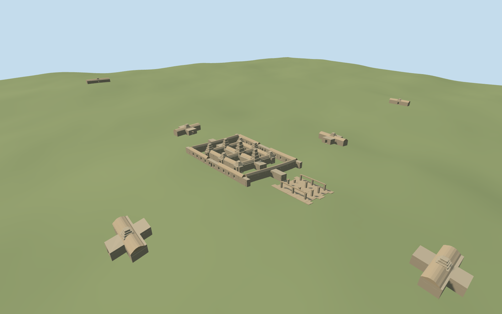

# banteay_kdei — Banteay Kdei

Reviewed2026-10-19 in one continuous author/build/inspect/fix round.

## Appearance

Inspected all52 final current source/shared/medium-fi/native-site/fallback views. Main gallery and inner four courts stay open; nine varied truncated, stepped stone prang stations, roof remnants, deep rectangular wall recesses and an open eastern pillar/lintel hall give the compound its specific organization. Eight gateways retain their mapped separation; the pictured face block is on the outer eastern gateway about353m away. In this round replaced overly smooth pyramid crowns with stacked storeys, then made the small moulded frames follow the taper to remove a detached railing appearance. Whole-library turntables cover the700x500m spread at small scale; four deliberate close views and native-site cameras carry architectural inspection. Surviving roof patterns, crown dimensions and hall pillar inventory remain medium-fi estimates.

## Shared materials and browser levels

Two reused256² graphs: stone_sandstone and stone_sandstone_raw, bound by metric UVs with linear stone tints. They are read once each through the production resolver. Zero embedded images or unique atlas; at most three draws. All four triangle caps, separate GPU streams, matching CPU/GPU byte accounting and initial486,912-byte geometry download pass. Eviction releases every loaded geometry.

| Level | Triangles | Bytes | Draws |
| --- | ---: | ---: | ---: |
| skyline | 1000 | 107660 | 1 |
| district | 3877 | 379252 | 2 |
| street | 14867 | 1487884 | 2 |
| closeup | 17169 | 1679756 | 2 |

Inspected current noon/late and economy/high comparisons, silhouette, close architectural views, each authored level and transition views. Warm neutral stone remains consistent across gallery, prangs and gateways. Distant levels simplify recesses/roof profiles and gateway cross plans while retaining broad courtyard organization, tower masses and spaced entrances. Synthetic style views are appearance checks; placement is judged from the separate retained native map/terrain fixture.

## Approximate map fit

Exact-QID relation3045422 fixes the main gallery axis. Ten standard-map building controls retain the main outer gallery, four inner courts and eight inner/outer gateways. Native east/south at heading0; the architectural axis is internal. Replace only those ten native shells, with a two-centimeter numeric mask tolerance; all167 independent in-tile buildings are byte-equivalent in the generator input. Standard native ground/water remain unchanged; no broad fabricated podium or terrain replacement. Long lower galleries follow coarse native grade, upright crowns use local center grade, and separate gateways keep local contact. Grade and thresholds are approximate. Failure preserves177 originals; allfour loaded levels leave167 independent buildings; unloading restores ground/water and releases geometry.

## Limits

Accepted medium-fi scope from three ordinary pictures and standard PMTiles/Mapzen data. No bespoke source campaign. Heights6.7–13.2m for main crowns,11.4m for the eastern face gate, exact signed small door details, other gateways' survival, repeated pillar count and roof-collapse inventory are approximate. Fine apsara/inscription carving, exact rubble, hidden interiors, full ancient spires, and unmapped enclosure walls/landscape are omitted. This is a recognizable mapped visualization, not a surveyed archaeological restoration. Physical-device and dense-city timings remain pending.

## Selected checks

Six Khronos files: zero errors/warnings.193 actual geometry/contact probes; 52 current inspected views. Scene validation/sim30 and strict selected medium-fi audit pass. Source and runtime hashes/material bindings/LOD caps verified.

Rebuild: node packages/worldgen/scripts/generate-additional-landmarks.mjs --ids=banteay_kdei; node packages/worldgen/scripts/import-structure-models.mjs --ids=banteay_kdei; node packages/tooling/scripts/generate-landmark-lods.mjs --ids=banteay_kdei --force.

Source: sha256:4e60fc6f5fa4e7d752336f8e324c1d2a56e5d7b727f8fc6f2596dfcc83f0f3b6

Runtime: sha256:458bac2674b6722480d25dee734b8f2a8606f4ca554be19bd4f3c312151a5856

Input: sha256:5ce1c44beb4819af6c909e00fc7989a5b3fb9ec536bc9f2a1946499d20865fb0

## Viewed ordinary pictures

https://commons.wikimedia.org/wiki/File:Prasat_Banteay_Kdei.jpg — Viktor Pinchuk; CC BY4.0; viewed only. Viewed only; no pixels copied.

https://commons.wikimedia.org/wiki/File:Angkor_temples.JPG — Colocho; CC BY-SA2.5; viewed only. Viewed only; no pixels copied.

https://commons.wikimedia.org/wiki/File:Banteay_Kdei_05.jpg — Stefan Fussan; CC BY-SA3.0 and other listed versions; viewed only. Viewed only; no pixels copied.
