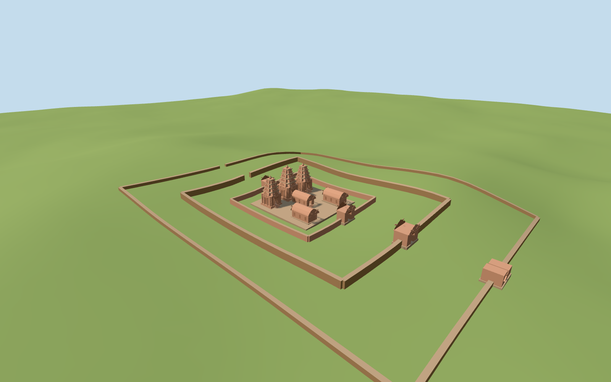

# banteay_srei — Banteay Srei

Reviewed 2026-10-19. Accepted for medium-fi surviving exterior and approximate standard-map fit. Built, inspected, corrected and completed in one continuous round.

## Architecture

Inspected the current portable, shared-material, medium-fi and actual-site renders in this authoring round. Three pink sandstone sanctuary towers retain their unequal heights, receding cruciform storeys, corner aedicules, lotus finials, recessed eastern doors and false west panels. Curved pediments, eastern mandapa, paired corbel-roofed libraries, inner gateways, lower outer/approach gateway remains and three enclosure traces complete the exterior. Corrected tower-tier gaps before the first render and then floating long enclosure walls on the sloping terrain. Far enclosure spans retain additional terrain segments after a concrete buried-wall check failed.

## Shared materials

Three reused 256² graphs: raw sandstone, coursed sandstone for laterite approximation, and weathered limestone for worn plinths/coping. Pink/brown linear tints and metric UVs; zero embedded images or unique atlases. Each graph loads once and eviction releases model geometry. Dense figurative carving is simplified into broad pediment/pilaster relief, without invented narrative figures.

## Browser levels

| Level | Triangles | Bytes | Draws |
| --- | ---: | ---: | ---: |
| skyline | 974 | 102140 | 1 |
| district | 3962 | 354620 | 3 |
| street | 8582 | 758000 | 3 |
| closeup | 15110 | 1334148 | 3 |

All 25 standard views inspected: noon/late, Economy/High, street/block/skyline, untextured silhouette, four architecture details, four authored levels and transitions. All four levels meet 1k/4k/16k/64k caps and at most three draws. Initial geometry 456,760 bytes; separate vertex streams avoid repeated GPU uploads. Flat stages intentionally expose terrain-relative wall foundations; actual ground contact is checked on retained terrain. Physical-device and dense-city timings remain pending.

## Geographic fit

Approximate fit on the retained standard Mapzen grid. Sanctuary/library/gateway plinths have buried retaining foundations; enclosure strips follow local coarse grade instead of floating at a constant center height. The eastern approach gate is lower on its local terrain. The central mapped building alone is replaced; all independent facilities, original ground and mapped moat remain native. Exact archaeological floors, wall damage, individual carving and seasonal water height are not surveyed. Model+X east,+Z south,heading 0. The west-view reference establishes false doors to the west; the mapped east–west causeway establishes the main approach. Only building 35184600057289 supplies the central 27×24m mapped envelope. Individual towers, libraries, gateways and walls are proportional picture/path/moat estimates rather than separately surveyed polygons. The distant eastern gateway is placed at the approach junction with explicit uncertainty.

## Scope and limits

Accepted as medium-fi surviving exterior with approximate standard-map fit. Exact carved narratives, individual statues, damage patterns, enclosure extents, archaeological floor levels and seasonal moat height are not surveyed or reproduced. Temple component proportions and gateway positions are visualization estimates. No navigable interior, ancient restoration or new terrain/water mesh is claimed. The native water and all 115 independent in-tile buildings remain unchanged; only the mapped central temple building is replaced to a sub-1e-7m² boundary remnant.

## Checks

Two registered recipes rebuild the 1,815,712-byte master. Six Khronos files: zero errors/warnings. 324 wall/grade probes pass. Inspected 52 current views: 9 portable, 9 shared, 25 medium-fi and 9 actual-site/fallback. Scene validation and sim 30 pass. Native ground, moat and independent buildings are unchanged; failed loading restores all 116 original map buildings and eviction frees geometry. Broad reproducibility and lock refresh remain batch work.

Rebuild: node packages/worldgen/scripts/generate-additional-landmarks.mjs --ids=banteay_srei; node packages/worldgen/scripts/import-structure-models.mjs --ids=banteay_srei; node packages/tooling/scripts/generate-landmark-lods.mjs --ids=banteay_srei --force.

Source: sha256:15bafb0e6bad53ef1f0e64fa194c5b76cbcb84b0299fb869da483026c8992b17

Runtime: sha256:8d6394e8fd47fdffd0cf47458cfbfea49809f5c728975bde95d9ec7cdb11ae54

Input: sha256:2f33eeaf79a5c96cd7bf48eb2136fec9e3ac993cb4293ef53092dee80805183a

## Ordinary pictures

https://commons.wikimedia.org/wiki/File:Banteay_Srei,_chef-dœuvre_de_lart_khmer_(6883279101).jpg — Jean-Pierre Dalbéra; 2011-12-14; CC BY2.0; viewed only. No pixels copied.

https://commons.wikimedia.org/wiki/File:Banteay_Srei,_chef-dœuvre_de_lart_khmer_(6883277703).jpg — Jean-Pierre Dalbéra; 2011-12-14; Reference photograph viewed only; consult Commons file page for reuse license. No pixels copied.
